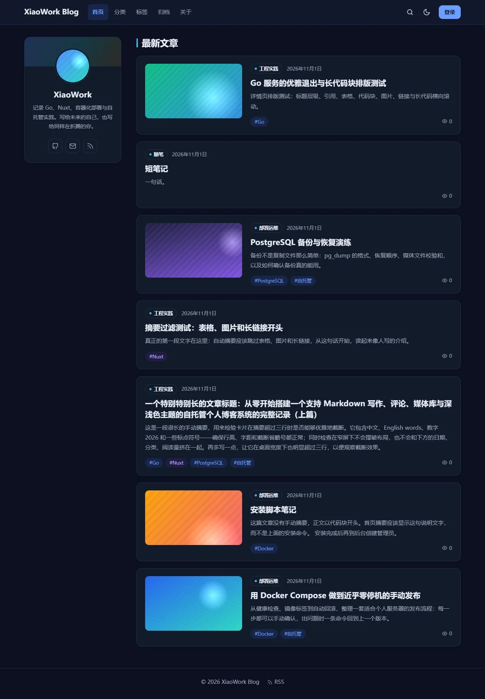
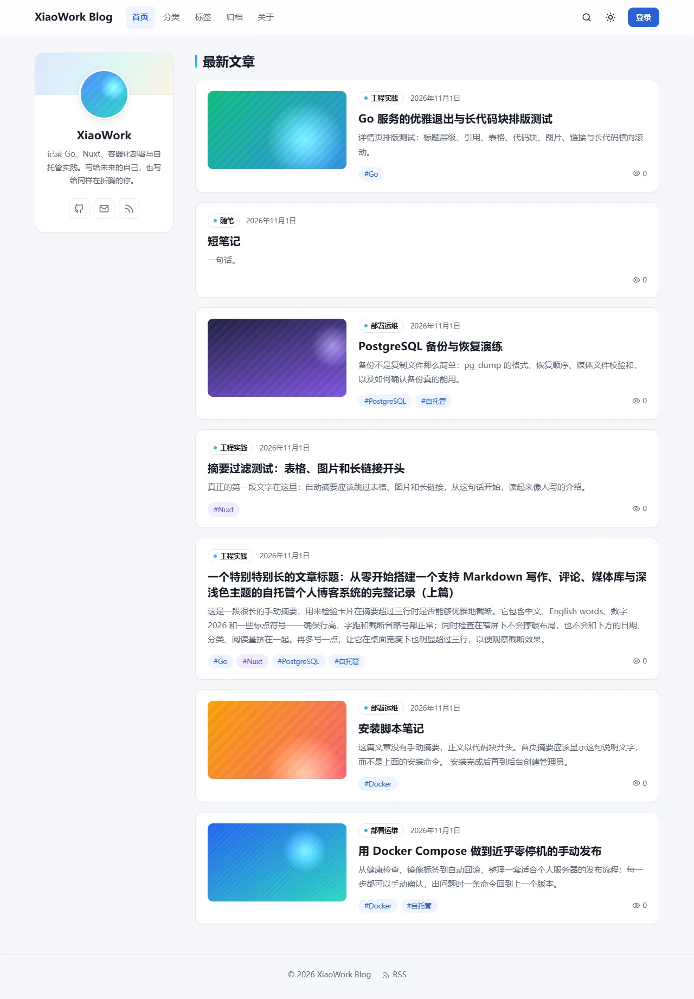
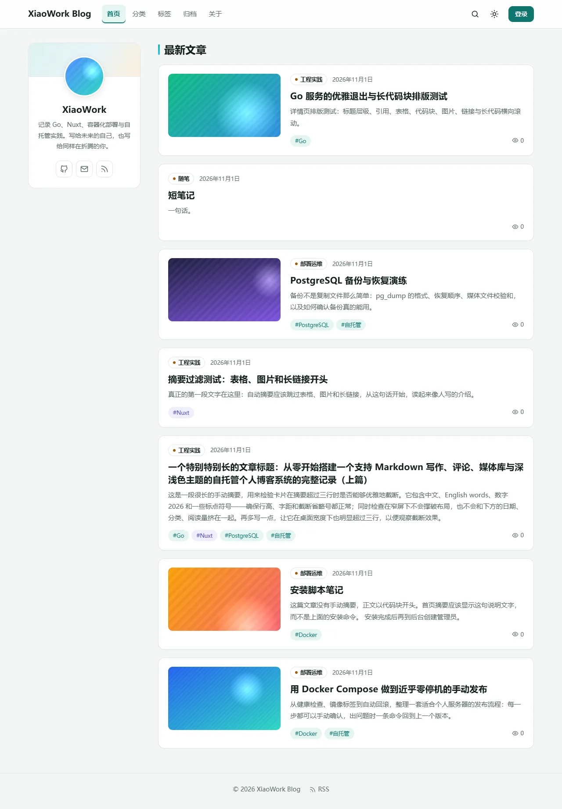
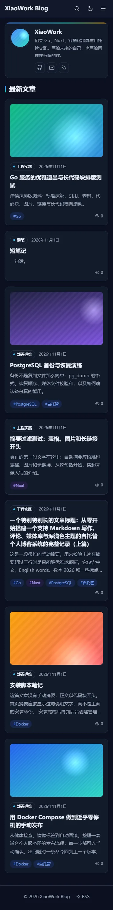
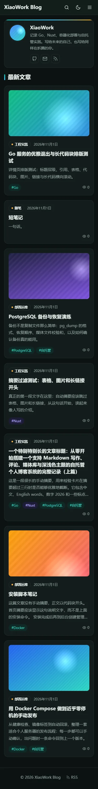

# XiaoWork Blog — P8-B10 交付记录（配色重设计：方案 B「墨绿青蓝」）

- 日期：2026-11-01
- 当前线上版本：`v1.0.0-rc.4`（项目负责人已验收）
- 下一候选版本：`v1.0.0-rc.5`（只准备发布说明草稿，**未创建标签或 Release**）
- 范围限制（全部遵守）：
  - 没有连接生产 VPS，没有修改生产数据或配置；
  - 没有改动 rc.1–rc.4 的标签与 Release。
  - 全部测试都在本机的隔离 Compose 项目 `xwb-ui` 中完成，结束后已删除。

## 1. 阶段名称和目标

**P8-B10：在“整体风格不变”的前提下重新设计全站颜色。**

1. 先提交三套概念图（A 石墨靛紫、B 墨绿青蓝、C 午夜珊瑚）。
2. 项目负责人选择了**方案 B**，随后正式实施，并完成测试、截图和文档。

## 2. 实际完成内容

1. 根据负责人提供的 rc.4 线上截图分析了问题：
   - 深色模式下背景、卡片、顶栏都是相近的深海军蓝，层次不清；
   - 蓝色 Logo 与蓝色封面落在蓝底上，显得发闷；
   - 资料卡色带在深色下从青绿过渡到棕色，看起来发浑。
2. 制作了三套概念图：用与博客相同的结构、负责人的真实内容（Logo、VPS脚本 封面、简介），每套都有浅色和深色，并核对了对比度。
3. 按方案 B 实施：
   - 替换 `main.css` 中浅色和深色两套 Token：背景、卡片、文字、边框、主色、三种点缀色、代码背景、阴影、焦点环、渐变；
   - 把原来写死在样式里的蓝色渐变改为 Token：`--profile-band`（按深浅主题分别定义）、`--title-bar`、`--mark-bg`；
   - 分类圆点改为琥珀色；
   - 导航当前页增加主色下划线；
   - 行内代码在正文和编辑器源码中统一为琥珀色。
4. 布局、组件结构、功能、API、数据库都没有改动。

## 3. 新增、修改的主要文件

| 文件 | 修改 |
|---|---|
| `apps/web/app/assets/css/main.css` | 方案 B 的浅 / 深 Token；新增 `--title-bar`、`--profile-band`、`--mark-bg`；焦点环改为青绿 |
| `apps/web/app/assets/css/blog.css` | 资料卡色带、标题竖条、搜索高亮改用 Token；分类圆点改为琥珀；导航激活态加下划线 |
| `apps/web/app/assets/css/articles.css` | 正文行内代码改为琥珀 |
| `apps/web/app/components/MarkdownEditor.vue` | 编辑器源码中的行内代码改为琥珀 |
| `docs/reference/XiaoWork_Blog_V1.0_UI_UX_Design.md` | §2.2.1 改为方案 B 的 Token 表与对比度 |
| `docs/adr/ADR-0012-P8B10方案B墨绿青蓝配色决策.md`（新） | 决策记录 |
| `CHANGELOG.md`、`docs/releases/v1.0.0-rc.5.md`（新，草稿） | rc.5 准备 |
| `docs/handoffs/assets/P8-B10/`（新） | 45 张 WebP：方案 B 概念图 + rc.4（改造前）与方案 B（改造后）对比截图 |

## 4. 实际执行的测试和结果

| 测试 | 结果 |
|---|---|
| 对比度（WCAG 相对亮度公式） | 浅色：次级文字 5.42–5.84、主色 5.08–5.47、标签 4.68–5.46、按钮 5.47。深色：次级文字 6.80–7.42、主色 9.25、标签 7.40–8.37、按钮 10.09。全部 ≥ 4.5 |
| Nuxt Typecheck | 通过（exit 0） |
| 前端单元测试 | 4 个文件，57 个测试全部通过 |
| 生产构建 | `apps/web/Dockerfile`（`--frozen-lockfile`）构建成功，容器 healthy |
| e2e（生产构建，隔离环境） | auth 23/23、media 11/11、articles 29/29、public 52/52、comments 47/47、admin 31/31 |
| 视觉截图 | 本机 Chrome 实际渲染，详见第 5 节 |

**说明**：

- 本机所有 e2e 请求来自同一个真实 IP，为避免触发“每 IP 注册限流”，测试 API 在整轮 e2e 期间临时信任 Docker 网关（与 P8-B8 的原因相同），结束后已恢复为 `172.16.0.0/12`。
- 本阶段没有改动 Go 代码；Go 测试以 CI 结果为准。

## 5. 视觉截图与验收

- **对比方式**：
  - 改造前：用 Git HEAD（即 rc.4 的代码）单独构建一个 web 镜像，端口 13301；
  - 改造后：用新代码构建，端口 13300；
  - 两者共用同一个隔离的 API 和数据库（7 篇测试文章：有封面 / 无封面 / 长标题 / 长摘要 / 长代码）。
- **覆盖范围**：1440 / 1280 / 768 / 375 四种宽度，深色和浅色，首页、详情页、有封面详情、单篇列表、空标签页、封面加载失败、编辑器。
- “改造前”没有编辑器截图：rc.4 web 运行在另一个端口，登录时 Origin 不一致，被 CSRF 拦截，这是测试方式的限制。
- 所有图片位于 `docs/handoffs/assets/P8-B10/`。

| 页面 | rc.4（改造前） | 方案 B（改造后） |
|---|---|---|
| 首页 1280 深色 |  |  |
| 首页 1280 浅色 |  |  |
| 手机 375 深色 |  |  |

其他截图：`after-post-d1440-*`、`after-post-m375-*`、`after-editor-*`、`after-broken-cover-*`、`after-empty-*`、`after-single-*`、`after-home-t768-*`，以及概念图 `concept-B.webp`。

**验收结论（自检）**：

- 实现效果与概念图一致；
- 深色模式下背景、卡片、顶栏层次分明；
- 四种宽度都没有横向溢出；
- 封面加载失败的降级、空状态、长标题、长代码块都正常。

## 6. 发现与修复的问题

- 编辑器源码中的行内代码仍是靛紫，与正文的琥珀不一致，已统一为琥珀。
- 原来写死在样式里的蓝色渐变（资料卡色带、标题竖条、分类圆点）在换配色时不会跟着变，已全部改为 Token。

## 7. 已知风险和未完成事项

- 配色属于主观审美，需要项目负责人在截图或线上确认。
- **邮件发送问题**（负责人在本阶段中途提出：注册后提示“验证邮件暂时没有发送成功”）不属于本阶段的代码改动。
  - 代码层面：每次发送失败，API 都会记录日志 `mail delivery failed` 和具体的 SMTP 错误；
  - 需要在服务器上查看该日志才能定位原因；
  - 排查步骤已在对话中给出；没有获得服务器授权，因此没有连接 VPS。
- rc.5 的标签与 Release 尚未创建，需要负责人确认。

## 8. Git Commit SHA 和 CI 结果

见第 11 节（推送后补记）。

## 9. 部署兼容性

- 只改了样式和一处编辑器配置：没有迁移，没有新增 `.env` 项，没有新增依赖，没有改动 Compose 文件。
- 更新方式与 rc.4 相同（`manage.sh update`，会重新构建 web 镜像），支持回滚。

## 10. 项目进度、下一版本建议与验收结论

- **进度**：
  - P0–P8 完成；
  - rc.1–rc.4 已发布，rc.4 已在生产运行并验收；
  - P8-B10 配色重设计已完成开发，等待验收。
- **建议**：
  1. 负责人确认方案 B 的实际效果后，发布 `v1.0.0-rc.5`。
  2. 在服务器上执行 `sudo deploy/manage.sh update v1.0.0-rc.5 --pre`。
  3. 另行排查邮件发送问题。
- **验收结论**：**等待验收**。

## 11. 推送与 CI 结果

（推送后补记）
