# XiaoWork Blog — P8-B8 交付记录（简洁 UI 保留、配色升级与文章封面优化）

- 日期：2026-10-25
- 当前线上版本：`v1.0.0-rc.3`（https://blog.xiaoworks.com，Docker + 1Panel OpenResty host-loopback）
- 下一候选版本：`v1.0.0-rc.4`（只准备发布说明草稿，**未创建标签或 Release**）
- 范围限制（全部遵守）：
  - 没有连接生产 VPS；
  - 没有修改生产数据库、文章、评论、媒体、`.env`、1Panel / OpenResty 配置；
  - 没有删除 Docker 数据卷；
  - 没有改动 rc.3 标签。
  - 全部开发与测试都在本机的隔离环境中完成（独立 Compose 项目 `xwb-ui`、独立的 Docker-in-Docker 升级演练容器）。

## 1. 阶段目标及完成范围

**目标**：在不改变“顶部导航 + 左侧个人资料栏 + 右侧文章列表”简洁布局的前提下，完成以下五项：

- 升级全站配色层次；
- 优化有封面和无封面的文章卡片；
- 修复首页摘要混入代码命令的问题；
- 优化资料栏、文章详情与 Markdown 编辑器；
- 保证深浅主题与各尺寸都美观，并且现有部署可以通过 `manage.sh` 手动更新。

**完成范围**：

| 要求 | 结果 |
|---|---|
| 3.1 有封面文章 | 16:9 统一比例、`object-fit: cover`、圆角协调、带固定尺寸属性（不出现布局跳动）、首两张优先加载其余懒加载、加载失败显示浅色占位 |
| 3.2 无封面文章 | 纯文字卡，标题 20 px / 700，摘要 3 行、行高 1.75，分类胶囊与日期区分，悬停时边框、阴影和 2 px 顶线；不显示空白占位 |
| 3.3 摘要优化 | 后端新增 `summaryText`，自动摘要跳过代码块、表格、图片、HTML、自动链接和长 URL；手动摘要优先；SSR / SEO / RSS 一致；无迁移、不改已发布内容 |
| 四、配色 | 浅色与深色两套 Token（蓝为主色，青 / 橙 / 紫为低饱和点缀，渐变只用于细线），所有文字对比度实测 ≥ 4.5:1 |
| 五、资料栏 | 功能不变；浅色顶带、头像描边、昵称与简介间距、外链按钮的悬停和聚焦状态、窄屏横排；没有增加任何组件 |
| 六、详情与编辑器 | 标题区层次、封面头图去重、代码 / 引用 / 表格 / 链接 / 图片样式；编辑器工具栏分组、模式分段按钮、主题化语法高亮。自动保存、发布、冲突检测未改动 |
| 七、视觉验收 | 浏览器实际渲染截图：4 种宽度 × 深浅主题 × 多种数据状态，共 50 张改造前后对比图 |
| 八、回归 | Typecheck、单元测试、Build、Go 全量测试、6 套 e2e、Compose 校验、rc.3 → 新代码 `manage.sh` 更新与回滚演练 |

## 2. 原 UI 存在的问题（基于改造前截图）

1. **摘要混入代码**：没有手动摘要的文章，首页显示 `sudo git clone https://… && sudo deploy/manage.sh install …`，或者“字段 说明 summary … 示意图 参考：https://…”。原因是自动摘要取自包含代码块的搜索全文 `plainText`。
2. **封面比例与位置**：封面为 16:10、200 px 宽，与标题不对齐，图文卡和文字卡的节奏不一致。
3. **懒加载与失败**：封面加载前、或加载失败时，只有一块灰底或破图图标；SSR 阶段发生的加载失败无法降级。
4. **层次单一**：分类、日期、阅读量都在一行灰色小字里；标签全是同一种蓝色；卡片悬停反馈很弱。
5. **资料卡**：外链图标没有边框，悬停 / 聚焦反馈弱，整体略显单薄。
6. **详情页**：
   - 代码块的 Tab 宽度为 8，并使用 Shiki 自带的背景色，与站点主题不协调；
   - 引用、表格样式简陋；
   - 正文已包含封面图片时，头图会重复显示。
7. **编辑器**：
   - 工具栏 14 个按钮没有分组；
   - 深色模式下 CodeMirror 默认语法颜色（深蓝 / 紫）在深色背景上难以辨认，当前行高亮过强。

## 3. 具体代码修改

| 文件 | 修改 |
|---|---|
| `apps/api/internal/article/markdown.go` | 新增 `summaryText`（遍历 Markdown AST，跳过代码块、缩进代码、表格、图片、HTML、自动链接；去除长度超过 30 的 URL 及紧贴的短标签；清理空括号）。`autoSummary` 的注释说明了输入来源 |
| `apps/api/internal/article/service.go` | 发布时 `FallbackSummary: autoSummary(summaryText(d.BodyMarkdown))`；`BodyPlainText`（搜索）不变 |
| `apps/api/internal/article/markdown_test.go` | 新增 `TestSummaryTextSkipsNoise`（代码、表格、图片、长链接、括号内链接、HTML、缩进代码、纯代码文章返回空、搜索文本仍含代码） |
| `apps/web/app/assets/css/main.css` | 新的浅 / 深 Design Tokens（`--border-strong`、`--teal/amber/violet(-soft)`、`--code-bg`、`--shadow(-hover)`、`--brand-gradient`）；按钮悬停；后台导航激活色条 |
| `apps/web/app/assets/css/blog.css` | 导航激活胶囊、资料卡、标题竖条、文章卡（16:9 封面、占位、悬停顶线）、分类胶囊、四色标签、详情页标题区 / 摘要块 / 头图、代码块头部、阅读进度条、响应式调整 |
| `apps/web/app/assets/css/articles.css` | Markdown 排版（行高 1.85、标题、链接、引用、行内代码、代码块 `tab-size: 4` 和 `--code-bg`、表格表头 / 斑马纹 / 不在单词中间断行、图片）；编辑器分段按钮、工具栏分组、CodeMirror 当前行 / 选区 / 光标；预览区宽度 |
| `apps/web/app/components/ArticleCard.vue` | 新结构（分类 + 日期 → 标题 → 摘要 → 标签 + 阅读数）；封面 `width/height`、`loading` / `fetchpriority`、`@error` 加挂载时检查的降级 |
| `apps/web/app/components/ArticleList.vue` | 前两张卡片设置 `priority` |
| `apps/web/app/components/ProfileCard.vue` | 头像失败降级为首字母；尺寸 92 |
| `apps/web/app/components/SiteIcon.vue` | 新增 `image` 图标 |
| `apps/web/app/components/MarkdownEditor.vue` | 基于 Token 的 Markdown `HighlightStyle` |
| `apps/web/app/pages/admin/articles/[id]/edit.vue` | 工具栏按功能分组并加分隔线 |
| `apps/web/app/pages/posts/[slug].vue` | 标题区重排；分类胶囊；封面头图与正文去重（`showCover`）；标签色调 |
| `apps/web/app/pages/tags/index.vue`、`apps/web/app/utils/public.ts`（`tagTone`）、`public.test.ts` | 标签按 slug 稳定映射四种色调，并补充单元测试 |
| `apps/web/package.json`、`pnpm-lock.yaml` | `@lezer/highlight@1.2.5` 改为直接依赖（原本就是 CodeMirror 的间接依赖，锁文件版本一致，只增加 3 行） |
| 文档 | `docs/reference/XiaoWork_Blog_V1.0_UI_UX_Design.md` §2.2.1（新 Token 与对比度）、`docs/adr/ADR-0011-…`、`CHANGELOG.md`（Unreleased）、`docs/releases/v1.0.0-rc.4.md`（草稿）、本记录与截图 `docs/handoffs/assets/P8-B8/` |

没有新增数据库字段或迁移，没有改动 API 契约。

## 4. 封面文章与无封面文章的展示结果

测试数据（只存在于隔离环境，由脚本生成）：7 篇文章，覆盖以下情况：

- 封面 16:9（1280×720）、竖图（600×900）、超宽（1500×420）、方图（800×800）；
- 无封面长标题 + 超长手动摘要；
- 无封面、正文以表格 / 图片 / 长链接开头且没有手动摘要；
- 无封面、正文以代码块开头且没有手动摘要；
- 短笔记；长代码排版测试文章。

| 场景 | 改造前 | 改造后 |
|---|---|---|
| 首页（1440，浅色） | 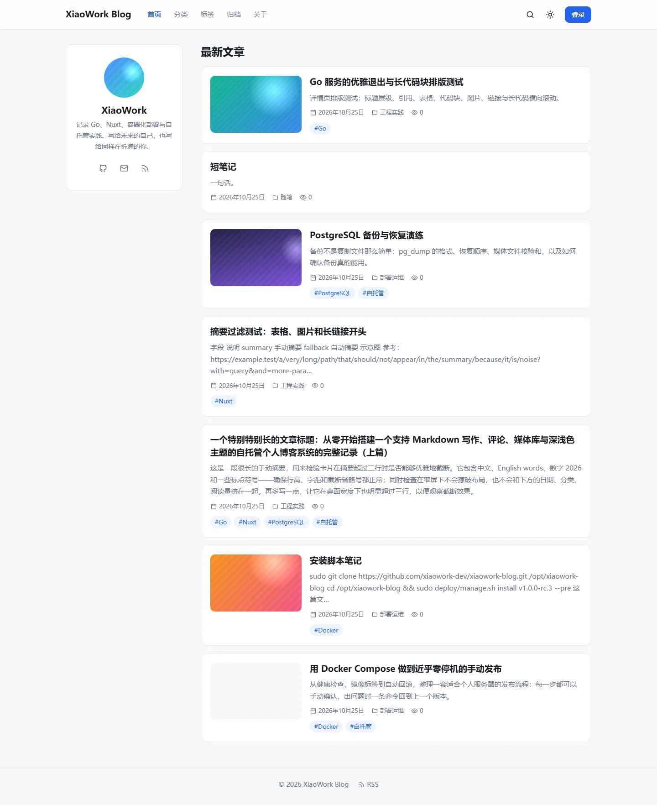 | 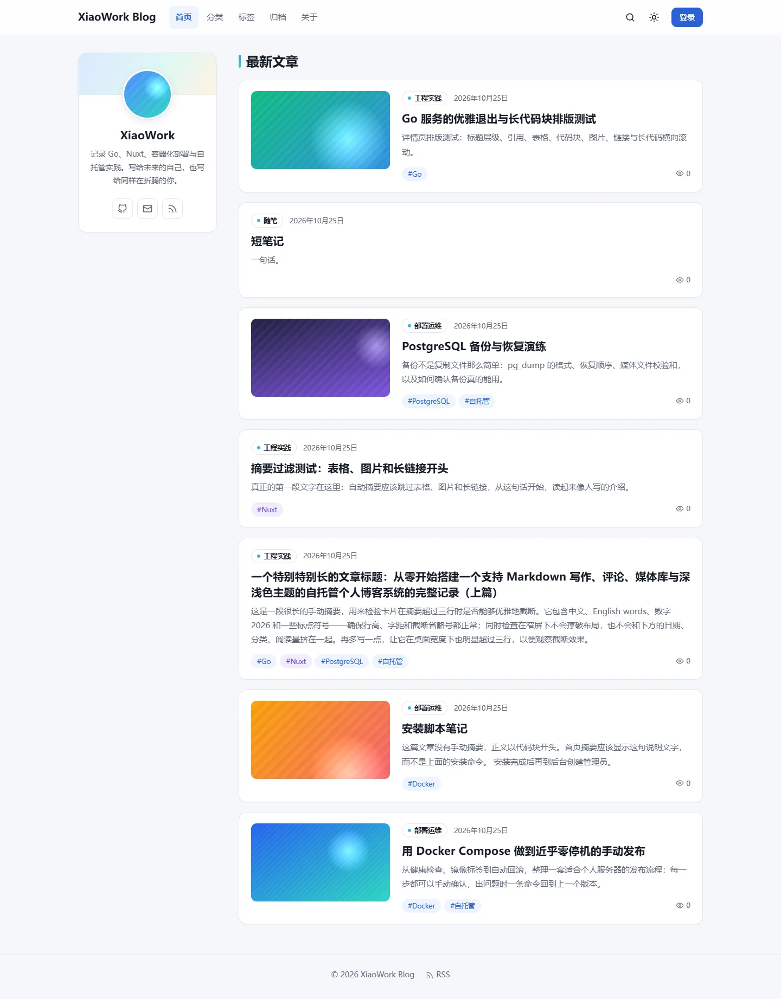 |
| 首页（1440，深色） | 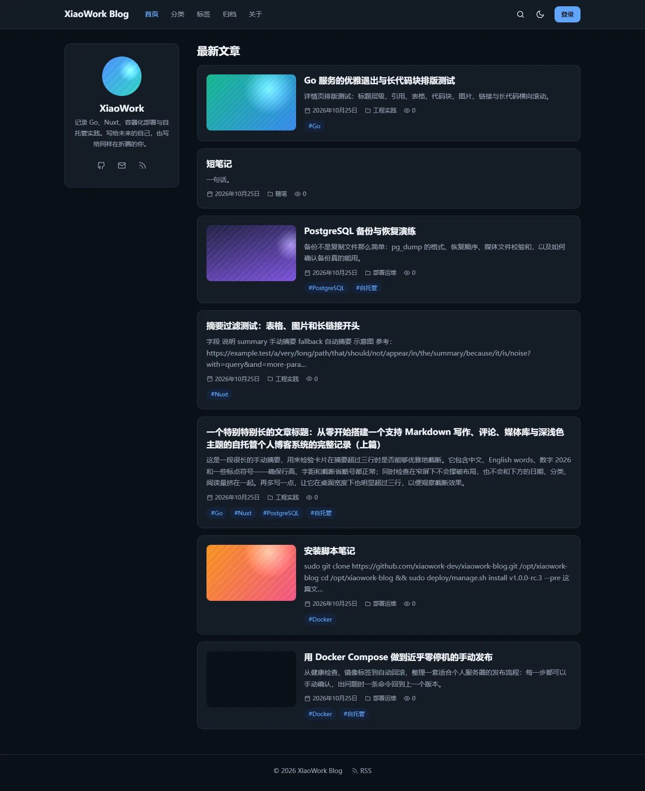 | 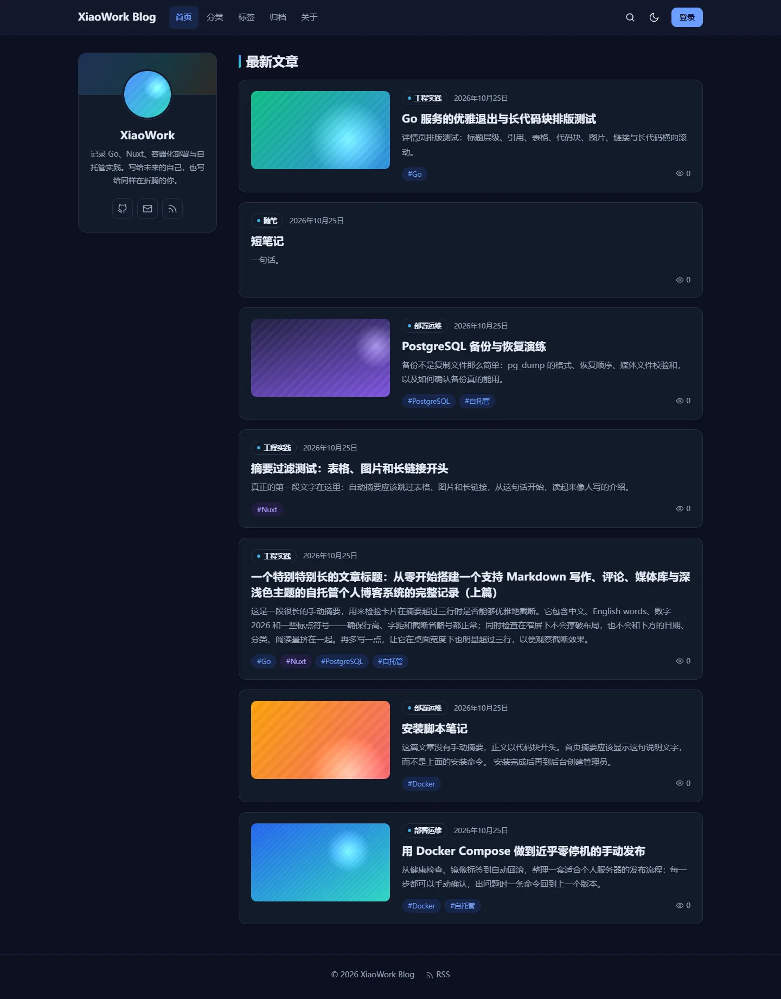 |

**结果**：

- **竖图、超宽图、方图都裁切为 16:9**，不变形，与卡片圆角一致。
- **自动摘要**：
  - 代码开头的文章显示“这篇文章没有手动摘要，正文以代码块开头……”；
  - 表格 / 图片 / 长链接开头的文章显示“真正的第一段文字在这里……”。
- **长标题**两行换行；**超长摘要**按行数截断（有封面 2 行、无封面 3 行），并显示省略号。
- **封面加载失败**（用浏览器拦截全部图片请求模拟）：显示浅色占位和图片图标，头像显示首字母，没有破图。

  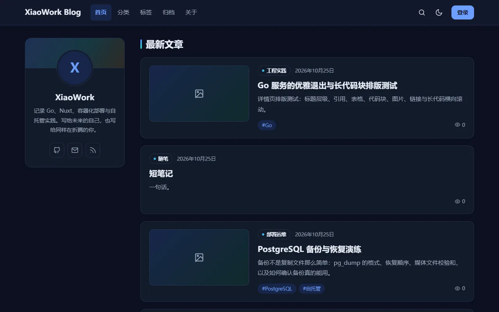

## 5. 视觉截图与验收结果

**截图方式**：

- 本机 Chrome 无头模式，通过 `playwright-core` 驱动；
- 设备像素比 1；
- 先滚动整页，触发懒加载后再截图；
- 改造前截图在开始修改前拍摄（同一套数据）。

全部 50 张图位于 `docs/handoffs/assets/P8-B8/`（WebP，约 4 MB）。截图只包含测试数据，没有管理员凭据或用户隐私。

| 尺寸 / 页面 | 浅色 | 深色 | 结论 |
|---|---|---|---|
| 桌面 1440 首页 | `after-home-d1440-light` | `after-home-d1440-dark` | 通过 |
| 桌面 1280 首页 | `after-home-d1280-light` | `after-home-d1280-dark` | 通过 |
| 平板 768 首页 | `after-home-t768-light` | `after-home-t768-dark` | 通过：资料卡横排，卡片左图右文 |
| 手机 375 首页 | `after-home-m375-light` | `after-home-m375-dark` | 通过：封面在上，16:9；无横向溢出 |
| 文章详情 1440（长代码、表格、引用、图片） | `after-post-d1440-light` | `after-post-d1440-dark` | 通过：代码横向滚动，正文不被撑宽 |
| 文章详情 375 | `after-post-m375-light` | `after-post-m375-dark` | 通过：表格可横向滚动，单词不在中间断开 |
| 有封面详情（头图） | `after-post-cover-d1280-light` | `after-post-cover-d1280-dark` | 通过 |
| 单篇文章列表（分类页） | `after-single-d1280-light` | `after-single-d1280-dark` | 通过 |
| 空标签页 | `after-empty-d1280-light` | `after-empty-d1280-dark` | 通过 |
| 首页无文章空状态 | `after-home-empty-d1280-light` | `after-home-empty-d1280-dark` | 通过（临时撤回全部测试文章后拍摄，之后已恢复） |
| 封面加载失败 | `after-broken-cover-d1280-light` | `after-broken-cover-d1280-dark` | 通过 |
| 编辑器 1440（分栏） | `after-editor-d1440-light` | `after-editor-d1440-dark` | 通过：工具栏单行分组，深色语法高亮清晰 |
| 编辑器 375 | `after-editor-m375-light` | `after-editor-m375-dark` | 通过 |

| 手机 375 首页（改造前 → 后） | 文章详情深色（改造前 → 后） | 编辑器深色（改造前 → 后） |
|---|---|---|
| 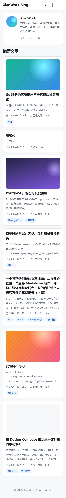 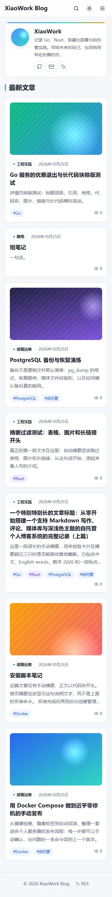 | 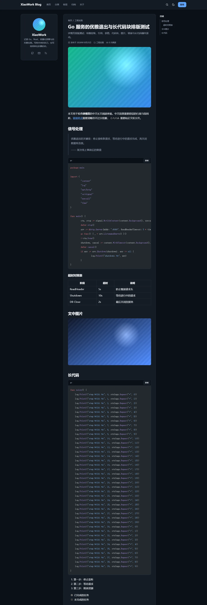 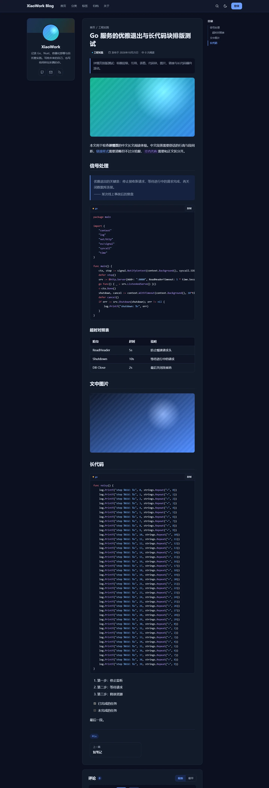 | 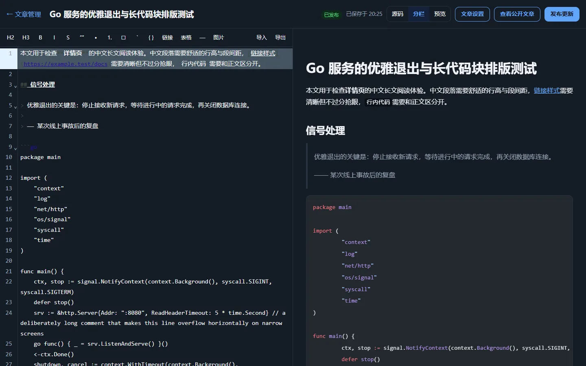 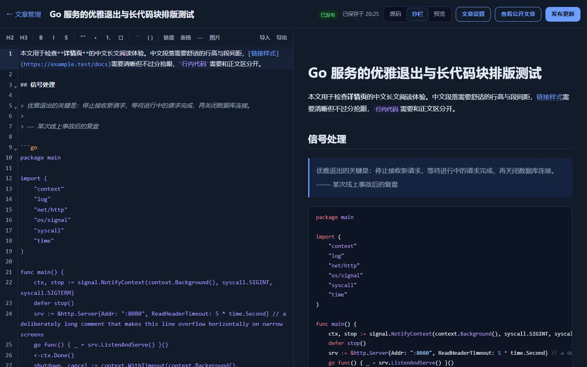 |

**对比度**（WCAG 相对亮度公式实测，详见 UI/UX §2.2.1）：

| 组合 | 浅色 | 深色 |
|---|---|---|
| 次级文字 | 5.41–5.81 | 7.00 |
| 强调蓝 | 5.52 | 6.55 |
| 标签文字（在各自浅底上） | 4.63–5.12 | 5.60–8.60 |
| 按钮文字 | 5.52 | 7.13 |

**参考站点说明**：没有访问 googhub.nyc.mn 与 blog.inybit.com，任务中也没有附带用户截图。设计依据是任务文字描述的方向（AiEDU 的封面卡片、InyBit 的色彩层次与精致卡片）以及项目的 UI/UX 文档，没有复制任何参考站点的配色或页面。

## 6. 实际测试情况

| 测试 | 环境 | 结果 |
|---|---|---|
| Nuxt Typecheck（`nuxt typecheck`） | 本机 Node 24.22.1 | 通过（exit 0） |
| 前端单元测试（vitest） | 本机 | 4 个文件，57 个测试全部通过（新增 `tagTone`） |
| 生产构建 | `apps/web/Dockerfile`（`pnpm install --frozen-lockfile` + `pnpm build`） | 通过，容器 healthy |
| Go：gofmt / vet / `go test ./...` | `golang:1.27.3-alpine` 容器（本机禁止运行临时目录中的测试可执行文件，因此在容器内运行） | 全部通过；新增 `TestSummaryTextSkipsNoise` |
| e2e（生产构建，`http://127.0.0.1:13300`） | 隔离 Compose 项目 `xwb-ui` | auth 23/23、media 11/11、articles 29/29、public 52/52、comments 47/47、admin 31/31 |
| SSR / SEO / RSS / Sitemap | 同上 | 文章页 `description`、`og:description`、RSS `<description>` 都是新摘要且三者一致；canonical 正确；RSS 返回 200 `application/rss+xml`；Sitemap 返回 22 个 `<loc>`；robots 正常 |
| 生产 Compose 校验 | 本机 Compose 5.6.0 | docker-network 与 host-loopback 两种模式 `config --quiet` 都通过 |
| 升级演练（与生产一致的 host-loopback） | Docker-in-Docker，rc.3 源码（`git archive v1.0.0-rc.3`） | 见下 |

**升级演练步骤**：

1. 用 rc.3 代码安装，写入 7 篇测试文章，备份。
2. 运行 `manage.sh update`，更新到本阶段代码：
   - 第一次更新时 `pnpm install` 拉取失败（第三方源网络波动）。更新在切换版本前中止，旧版本继续运行，数据无变化。
   - 手动用同一锁文件构建成功，证明是网络问题而不是依赖问题。
   - 重试更新成功：结构版本 7 → 7，数据完全一致，`.env` 未改动，web/api 仍只监听 127.0.0.1。
3. 新 UI 已生效；旧文章摘要保持原样，编辑并“发布更新”后变为新摘要。
4. 手动回滚到 rc.3：旧 UI，站点 200。再切回新版本：数据一致。

**测试环境说明**（如实记录）：

- **评论 e2e 第 6 项首次失败**：本机所有请求来自同一个真实 IP，第 4 次注册触发了“每 IP 每小时 3 次”的注册限流（API 日志中为 429）。临时把 Docker 网关加入测试 API 的可信代理后重跑 47/47 通过，随后已恢复原设置。这与 P8-B6 演练中的做法相同，不是代码回归。
- 截图过程中多次登录触发了登录限流。测试库中清空了 `auth_rate_windows` 后继续，只涉及测试环境。

## 7. 发现与修复的问题

1. **摘要混入代码命令**（任务要求）：已修复，见第 3 节。修复后发现长链接前的“参考：”残留，已改为连同标签一起去除。
2. **SSR 阶段图片失败不能降级**：Vue 绑定 `@error` 之前图片已经失败，仍显示破图。已增加挂载时 `complete && naturalWidth === 0` 检查，封面与头像都已修复。
3. **编辑器工具栏换行**：增加分组后，1440 分栏模式下“导出”掉到第二行。已收紧按钮内边距，现在为单行。
4. **手机端表格单词断开**（“ReadHead / er”）：表格已可横向滚动，因此改为表格内不在单词中间断行。
5. **截图懒加载造成假空白**：整页截图前先滚动页面，与真实浏览一致。这只是测试方法问题。
6. **升级时 npm 源网络失败**：网络问题，并非代码问题；已在 rc.4 发布说明中提示可设置 `NPM_REGISTRY`。

## 8. Git Commit SHA 和 CI 结果

| 对象 | SHA | CI |
|---|---|---|
| P8-B8 代码与文档 | `8b30a7bf6461133c459cb2a91fedc5275ffab833`（已推送到 `origin/main`，远端 SHA 已核对） | [#43](https://github.com/xiaowork-dev/xiaowork-blog/actions/runs/40203125908) **success**：web、api、compose、db-integration、deploy 全部通过 |

- `v1.0.0-rc.3` 标签仍指向 `c95f9a3`（标签对象 `5edfe22`），未改动。
- 未创建 rc.4 标签或 Release。

## 9. 现有部署兼容性及风险

- **兼容性**：
  - 没有数据库迁移，没有新增 `.env` 配置；
  - NPM 与 1Panel host-loopback 两种模式的 Compose 文件都没有改动；
  - 在 host-loopback 模式下已演练 `manage.sh update`（rc.3 → 新代码）与 `rollback`。
- **风险与注意事项**：
  1. **已发布文章的旧自动摘要不会自动改写**：需要作者编辑并“发布更新”，或填写手动摘要。这是为了遵守“不得修改已发布内容”。
  2. **更新时 web 镜像需要从 npm 源安装依赖**：服务器网络不稳定时更新可能失败。失败会安全中止，可以重试，或设置 `NPM_REGISTRY` 镜像。
  3. **参考站点和用户截图都没有实际查看**：视觉方向是依据文字要求的设计判断，需要项目负责人主观验收。
  4. **对比度只计算了 Token 组合**：没有逐页做自动化无障碍扫描。
  5. **封面图仍使用原图**：没有缩略图变体，与 rc.3 相同。首屏只有前两张优先加载，其余懒加载。

## 10. 项目当前进度、下一版本建议和验收结论

- **进度**：
  - P0–P7 功能完成；
  - P8 部署体系完成；
  - rc.1 / rc.2 / rc.3 已发布；
  - rc.3 已在生产运行（1Panel host-loopback）；
  - P8-B8 视觉升级开发完成，等待验收。
- **下一版本建议**：
  1. 项目负责人查看第 5 节的截图（或拉取代码在本地运行），确认配色与卡片效果。
  2. 确认后，在本阶段最终提交上发布 `v1.0.0-rc.4` 预发布：发布说明使用 `docs/releases/v1.0.0-rc.4.md`，并把 CHANGELOG 的 Unreleased 移到正式条目。
  3. 项目负责人在 VPS 上执行 `sudo deploy/manage.sh update v1.0.0-rc.4 --pre`，然后对首页摘要有问题的文章“编辑 → 发布更新”。
  4. 线上验收通过后，再决定是否在同一提交上发布 `v1.0.0`。
- **验收结论**：**等待验收**。开发、测试与文档已完成；已推送，CI #43 全部通过；rc.4 标签与 Release 按要求未创建。

## 11. 推送与 CI 结果

- `8b30a7b` → CI #43 success（见第 8 节）。
- 本记录的补记提交推送后，其 CI 结果在对话的验收总结中报告。
