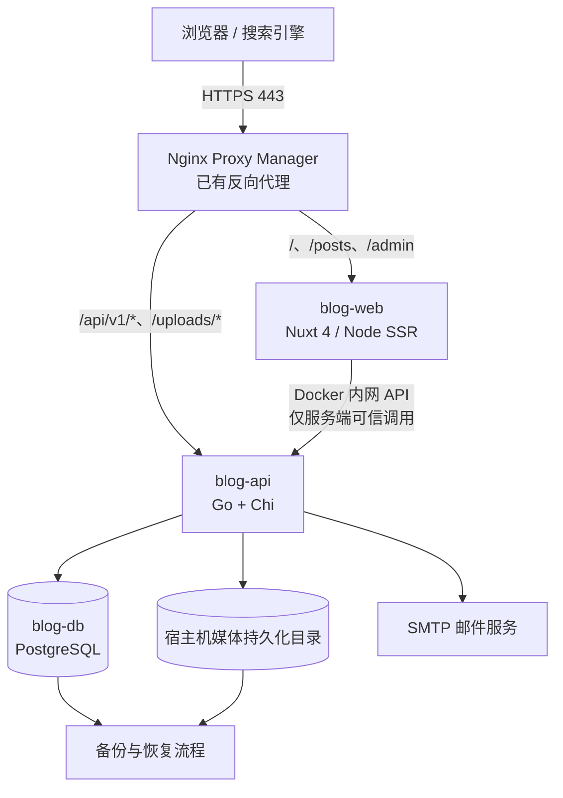
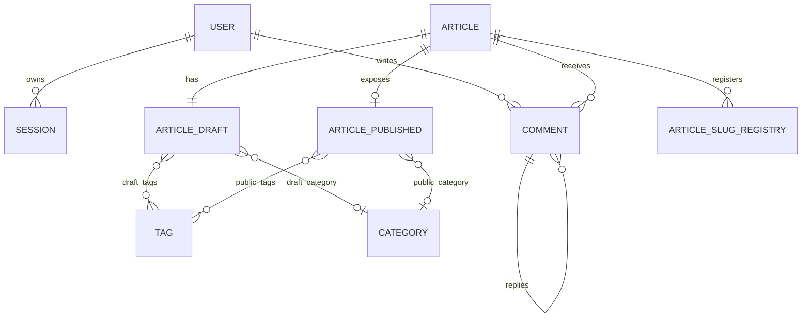
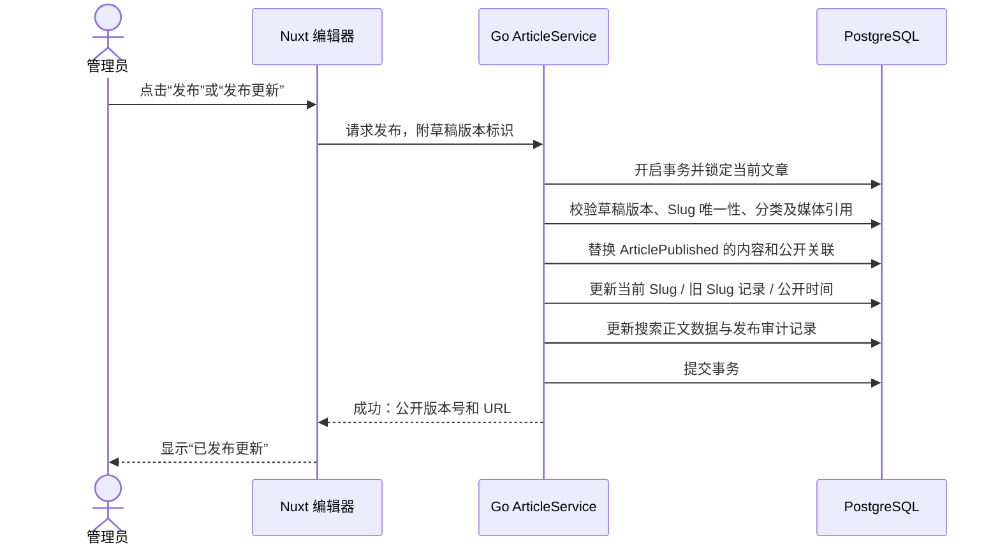

# XiaoWork Blog V1.0 系统架构设计说明书（SAD）

> **文档版本：** V1.0-Draft 1（架构评审稿）  
> **日期：** 2026-10-22  
> **项目阶段：** 需求基线已建立，正在进行架构设计；**尚未开始编码、建仓、部署**  
> **上游文档：** 《XiaoWork Blog V1.0 产品需求文档（PRD）》（2026-10-22）  
> **用途：** 为下一阶段数据库逻辑模型、API 契约、UI 详细设计和 Agent 开发提供统一架构约束。本文并非可直接运行的代码或部署脚本。

---

## 0. 执行摘要与决策状态

**用户已确认（不得擅自更改）：**
- 主技术路线：**Nuxt + Go**；前端 SSR、后端独立 API；V1.0 暂不开始编码。
- 网站定位：从零开发完整个人博客，不直接部署现成博客。
- 页面：**左侧简洁个人信息栏 + 右侧文章**，现代简约；左侧只保留头像、昵称、简介和少量外链图标，外链可后台配置。
- 文章：Markdown 源码编辑 + 实时预览；**已公开版本与编辑草稿分离**，只能由管理员手动发布更新。
- 账号：邮箱 + 密码注册，邮箱验证，忘记密码和邮件找回。
- 评论：**登录且邮箱已验证后可评论；合法评论立即公开；管理员事后管理，不设审核队列**。
- 图片：**自己的服务器本地文件系统**，通过 Docker 持久化目录保存。
- 工程规范：一键 Docker 部署；每阶段交付文档；接入 GitHub 后正式版本更新须提交并推送。

**本轮推荐并作为架构设计基线（可在实施前评审微调）：**

| 层次 | 选型 | 选择理由 / 边界 |
|---|---|---|
| 前端 | Nuxt 4、Vue 3、TypeScript | SSR、SEO、统一前台/用户中心/管理后台 |
| 样式组件 | Tailwind CSS 4、Nuxt UI | 前台可独立设计，后台高效率搭建 |
| 后端 | Go 1.27.x、Chi v5、`net/http` | 轻量 HTTP API，按领域模块组织 |
| 数据库 | PostgreSQL 18（推荐锁定一个受支持的主版本） | 关系约束、事务、索引、可用于初期搜索 |
| DB 访问 | pgx v5 + sqlc | 显式 SQL、可生成类型安全代码，不绑定重 ORM |
| 迁移 | goose（推荐） | 迁移版本可追踪；具体发布前验证兼容性 |
| 编辑器 | CodeMirror 6 | Markdown 源码/实时预览 |
| Markdown 展示 | Markdown-it + Shiki + 安全净化规则 | 渲染文章、代码高亮；禁止不可信 HTML 直接执行 |
| 认证 | PostgreSQL 持久化 Session + 安全 Cookie | 支持主动退出、封禁、失效控制；V1.0 不依赖 Redis |
| 邮件 | SMTP 驱动 / 可替换邮件适配层 | 验证邮箱、找回密码 |
| 搜索 | PostgreSQL 公开正文索引 + `pg_trgm`/全文检索 | 不引入 Elasticsearch；中文搜索效果需真实数据验收 |
| 部署 | Docker Compose + 既有 Nginx Proxy Manager | 三容器：Web、API、DB；同域路径代理 |

> **版本原则：** 2026-10-22 可用 Go 1.27.3；Nuxt、Go 依赖、PostgreSQL 容器镜像必须在实施时锁定并通过测试，不能长期使用可漂移的 `latest` 标签。本文件中的版本是架构基线，不代表已安装。

## 1. 设计目标及不做事项

### 1.1 设计目标
1. 公开页面可被搜索引擎获取完整内容；良好移动端阅读体验。
2. 登录、注册、评论、管理员管理形成可测试的完整闭环。
3. 编辑草稿不能污染公开文章；手动发布是唯一公开切换点。
4. 同一服务器小规模运营，尽量减少进程、数据库和第三方服务数量。
5. 用户、文章、评论、图片数据可持续升级、备份和恢复。
6. 部分业务未来可扩展，但不得为了未来的不确定需求引入微服务或消息队列。

### 1.2 明确不做
V1.0 不引入 Redis、Elasticsearch、RabbitMQ、Kubernetes、外部对象存储、第三方登录、评论审核队列、消息通知、点赞收藏、完整文章历史版本回滚、多作者协作或复杂 RBAC。

### 1.3 约束与风险
- Nuxt 的 SSR 需要 **Node.js 运行时**；Go 不能取代其 SSR 进程。
- Nuxt **不直接连接数据库**，所有业务数据通过 Go API 获取。
- 邮件由 SMTP 提供：发信服务的可靠性、域名 DNS、速率限制将影响注册闭环。
- 本地媒体必须考虑单机磁盘故障，容器挂载**不是**完整备份。
- 中文搜索与英文分词机制不同；初版必须使用中文文章样本验收搜索可用性。

## 2. 总体架构

### 2.1 容器与网络（C4 容器视图）



- **一个公开域名**；NPM 按 URL 路径转发，不需要在浏览器里配置 Go API 的独立域名。
- 仅反代向公网提供 80/443；Web、API、DB 之间优先使用 Docker 内网互通。
- **数据库绝不公开端口**。若既有 NPM 与项目不在同一 Docker 网络，可经受控网络对接；禁止为方便调试而给内部服务开放所有网卡端口。
- Nuxt 服务端使用内网 API 地址；浏览器统一请求同域 `/api/v1/*`。不得在浏览器打包产物中泄露 Docker 内部域名或密钥。

### 2.2 URL 边界与渲染策略

| 路径 | 所属服务 | 访问特点 | 渲染/缓存原则 |
|---|---|---|---|
| `/` `/posts/:slug` | Nuxt | 匿名公开 | SSR；默认动态正确性优先，不先强开整页缓存 |
| `/categories/*` `/tags/*` `/archives` `/search` `/about` | Nuxt | 匿名公开 | SSR；只展示已公开内容 |
| `/auth/*` | Nuxt | 游客与注册用户 | 不缓存认证敏感内容 |
| `/account/*` | Nuxt | 登录用户 | 私有页面，`Cache-Control: private, no-store` |
| `/admin/*` | Nuxt | 管理员 | 私有页面，禁止共享缓存与索引 |
| `/api/v1/public/*` | Go | 可匿名访问 | 只返回公开对象 |
| `/api/v1/auth/*` `/api/v1/me/*` | Go | 认证流程 | 禁止共享缓存 |
| `/api/v1/admin/*` | Go | 管理员 | Go 服务端严格鉴权，禁止共享缓存 |
| `/uploads/*` | Go | 图片文件访问 | 依媒体可见性控制，已公开资源可合理长缓存 |

- **禁止“SSR 页面有权限，API 不校验权限”**。所有敏感动作在 Go API 终点再次校验身份与权限。
- 公开文章正文使用 SSR 确保 SEO；评论列表可以单独请求、分页，并在提交成功后及时刷新，不应被整页缓存阻碍。
- 在实现可靠的发布后失效机制以前，不开启文章详情页长时间 `swr`/CDN HTML 缓存；静态 JS/CSS 可强缓存并带内容哈希。
- Nuxt 端 SSR 只能向**预配置的可信内网 API**转发必需的 Cookie/请求头，不可把浏览器请求头任意转发至用户可控 URL，避免 SSRF 与会话泄露。
- 对搜索引擎应返回正确的 HTTP 状态：404 未找到或不公开；301 已发布文章的旧 Slug；正常公开内容 200。

### 2.3 责任边界

| 关注点 | Nuxt | Go API |
|---|---|---|
| 页面布局、主题、响应式 | 主要负责 | 不涉及 |
| 文章 SEO、SSR HTML、客户端导航 | 主要负责 | 提供公开元数据 |
| Markdown 源码编辑与预览 | 编辑器 UI 与预览 | 持久化 Markdown、校验与公开转换策略 |
| 用户登录表单、显示用户资料 | 展示和交互 | 认证/权限、Session、邮箱验证 |
| 草稿保存/文章发布按钮 | 调用 API | **唯一业务规则执行方** |
| 评论展示/提交 | 显示与交互 | 鉴权、反刷、存储、隐藏删除 |
| 图片上传 UI | 上传交互 | MIME/文件验证、存储与可见性 |
| 数据迁移、备份、审计 | 不负责 | 后端/运维流程负责 |

## 3. 后端：模块化单体

### 3.1 分层设计

`HTTP Router / Middleware → Handler（请求与响应）→ Service（领域规则）→ Repository（SQL）→ PostgreSQL`。

- **Handler**：参数解析、输入校验、返回统一 JSON、HTTP 状态码。
- **Service**：事务、权限、文章发布、评论可见性、注册令牌状态机。
- **Repository**：SQL、pgx、sqlc 生成类型；不得绕过业务层直接修改公开内容。
- **Adapter**：SMTP、媒体文件、本地时钟/ID、可替换外部依赖。
- 公共工具包只放跨领域通用代码，不能把所有业务逻辑堆进 `utils`。

### 3.2 功能模块边界

| 模块 | 主要职责 | 核心依赖 |
|---|---|---|
| `auth` | 注册、邮箱验证、登录、Session、密码重置 | `user`、`mail`、数据库 |
| `user` | 用户资料、头像、账号状态、管理员权限 | `media`、数据库 |
| `article` | 文章实体、草稿、公开快照、发布、撤回、回收站、Slug | `taxonomy`、`media`、数据库 |
| `taxonomy` | 分类、标签、文章关联与排序 | 数据库 |
| `comment` | 发表评论、回复、分页、删除占位、管理员事后隐藏/删除 | `auth`、`article`、数据库 |
| `media` | 上传、临时文件、图片检查、访问控制、删除引用检查 | 文件系统、数据库 |
| `search` | 已发布正文的搜索与索引维护 | `article`、数据库 |
| `site` | 博客名称、个人资料栏、外链图标、导航、SEO 默认值 | 数据库 |
| `admin` | 控制台摘要、重要操作审计 | 各领域只读统计/审计接口 |
| `mail` | 发信驱动、超时、失败重试语义 | SMTP |

**模块交互规则**：跨模块业务调用走 Service 公开接口；同一次文章发布的跨表写入使用同一 DB 事务；不为每个模块启动独立服务。

### 3.3 Go 工程结构（目录示意，非已创建目录）

```text
xiaowork-blog/
  apps/
    web/                     # Nuxt 应用
    api/
      cmd/server/             # Go API 入口
      internal/
        auth/
        user/
        article/
        taxonomy/
        comment/
        media/
        search/
        site/
        admin/
        mail/
        platform/             # config / http / db / logging
      db/
        migrations/           # 数据库迁移脚本（后续设计）
        queries/              # sqlc 使用的 SQL
      tests/
  deploy/                     # Docker、备份等（后续实现）
  docs/
    PRD.md
    ARCHITECTURE.md
    API.md
    DATA_MODEL.md
    DELIVERY_LOG.md
  .github/workflows/           # CI/CD（后续实现）
```

## 4. 核心领域模型（概念级；此轮不写 DDL）

### 4.1 模型边界

| 逻辑对象 | 关键规则 |
|---|---|
| `User` | 邮箱唯一；角色 USER/ADMIN；邮箱验证状态与禁用状态分离 |
| `Session` | 服务端可撤销；到期、主动登出、重置密码、账号禁用均有失效路径 |
| `OneTimeToken` | 邮箱验证/密码重置令牌摘要，不存可复用明文 |
| `Article` | 稳定 ID、作者、生命周期状态、初次发布时间；评论始终关联 Article ID |
| `ArticleDraft` | 仅管理员可读写，编辑中的标题/正文/封面/分类/标签/SEO/Slug |
| `ArticlePublished` | 公开快照，包含**本次发布实际生效**的全部文章字段 |
| `ArticleSlugRegistry` | 当前 Slug 与历史 Slug 共享唯一性空间；历史链接可 301 |
| `Category`、`Tag` | 已公开与编辑草稿关联必须分别处理，不能让改标签提前上线 |
| `Comment` | 评论文章、作者、父评论、回复目标、内容、隐藏/删除状态 |
| `MediaAsset` | 随机文件标识、内部相对路径、媒体类型、尺寸、大小、可见性和引用 |
| `SiteSettings` / `ExternalLink` | 网站设定、左侧图标名称、地址、排序、启用 |
| `AdminAuditLog` | 文章发布、撤回、用户封禁、评论隐藏/删除等重要动作 |

### 4.2 逻辑关系图



> 图中的实体与关联用于明确业务隔离，不暗示直接采用上述表名，也不代表已经确定主键、外键或具体表数。

## 5. 文章发布：最关键的事务边界

### 5.1 新建与保存
1. 创建文章实体 `Article` 和独立 `ArticleDraft`。
2. 所有编辑行为（标题、正文、封面、分类/标签、Slug、SEO、评论开关）**只写草稿**。
3. 客户端编辑器防抖自动保存，服务器用草稿版本号/乐观锁，避免多标签页旧写入覆盖新内容。
4. 文章预览要求管理员鉴权，默认不可被公开搜索或外部访问。

### 5.2 首次发布与发布更新



- **原子性：** 发布要么整套字段/关联生效，要么都不生效；不能出现“正文更新、标签还是旧版”。
- **并发冲突：** 草稿版本落后时返回 `409 CONFLICT` 并要求管理员重新确认。
- **时间：** 首次发布时间仅首次成功发布时设置；公开更新时间仅成功发布更新时变化；自动保存时间单独维护。
- **评论归属：** 评论绑定 `Article` 稳定 ID，更新后继续存在。
- **Slug：** 草稿可以修改候选 Slug，直到发布时才影响当前公开地址；旧 Slug 只对当前仍公开的文章 301 重定向，撤回/删除后不得暴露内容。旧 Slug 不再分配给别的文章。
- **软删除/撤回：** 立即改变 Article 的对外可见状态；恢复默认回到不公开状态，需手动再次发布。
- **发布后同步：** 将公开纯文本搜索字段在同一事务里更新；站点地图/RSS 动态基于公开数据生成，避免必须另引入异步消息队列。
- **缓存：** 首版对文章 HTML 采用保守缓存，确保点击发布后新内容可被下一次请求读取；需要高性能再完善明确的失效机制。

### 5.3 Markdown 双通道安全
- 草稿持久化 **原始 Markdown**；编辑器预览与公开阅读使用一致的 Markdown 语法规则。
- 公开渲染可在 Nuxt 进行，但 Go 端必须掌握公开/私有边界，且输入校验不能只靠前端。
- 禁止不受控的内嵌 HTML；对生成 HTML 的元素、链接协议和图片 URL 使用允许列表/净化处理；代码块必须正确转义。
- 发布时维护供搜索用的纯文本正文，避免 SQL 搜索索引扫描 Markdown 标记。

## 6. 登录、邮箱和权限

### 6.1 Session 方案
- 密码使用 **Argon2id**，独立随机盐；参数在测试服务器上校准且不得低于安全基线。
- 登录成功生成高熵随机 Session 凭据，**数据库只保存令牌校验摘要**（例如 SHA-256 摘要），服务端可随时撤销。
- Cookie 推荐 `__Host-xiaowork_session`，设 `HttpOnly; Secure; SameSite=Lax; Path=/`，**不设置 Domain**；仅 HTTPS 正式环境启用。会话轮换与过期策略在接口设计阶段量化。
- 不把 Session ID、JWT、邮箱验证令牌放入 `localStorage`。
- 服务端每次敏感动作校验数据库用户状态、邮箱是否已验证、角色与对象所有权，不只信任“登录时的身份”。
- **CSRF 保护：** 对状态更改请求使用服务端验证的 CSRF Token（如 synchronizer-token）并校验 Origin/Fetch Metadata；Cookie 的 SameSite 不能代替服务端防护。登录/登出等改变会话状态的入口同样适用防护。
- 认证、用户中心、管理后台返回 `private, no-store`，任何 SSR 个性化页面和 API 都不能进入共享缓存。

### 6.2 权限矩阵（摘要）

| 资源/操作 | 游客 | 未验证用户 | 验证用户 | ADMIN |
|---|---:|---:|---:|---:|
| 阅读公开文章/评论 | ✓ | ✓ | ✓ | ✓ |
| 提交/回复评论 | × | × | ✓ | ✓ |
| 删除自己的评论 | × | 条件受限 | ✓ | ✓ |
| 修改自己的资料/密码 | × | ✓ | ✓ | ✓ |
| 文章草稿/公开发布 | × | × | × | ✓ |
| 查看全部用户/禁用账号 | × | × | × | ✓ |
| 评论隐藏/删除他人评论 | × | × | × | ✓ |
| 媒体库管理 | × | × | × | ✓ |

> 删除自己的评论时，未验证用户的历史评论是否存在并非正常路径；落地时统一执行“登录 + 资源所属关系”校验，并且对禁用账号拒绝写操作。

### 6.3 注册、邮件验证与找回密码
- 邮箱唯一性在数据库唯一约束中落实；公开响应尽可能避免账号枚举与信息泄露。
- 注册成功创建待验证账户；邮件发送失败时向用户明确提示发信未完成并允许按限流规则重发，不能声称已发出。
- 验证和重置令牌由安全随机源生成，数据库只存摘要，**一次性消费且有有效期**；建议邮箱验证 24 小时、重置密码 30 分钟（可配置）。
- 所有令牌验证与消费必须在事务中保证一次性，重复请求或并发点击不得重复生效。
- 找回密码页面向外部提供一致反馈（无论邮箱是否注册）；更新密码后使旧重置令牌失效，并按安全策略撤销其他 Session。
- SMTP 超时、临时失败、重复发送、邮件限流和日志脱敏都要在测试中覆盖；不新增独立队列服务。
- 初始 ADMIN 只通过受保护的首装流程/命令创建；公开注册接口永远只创建 USER。

## 7. 评论模型和防滥用

### 7.1 一条评论的生命周期
`提交 → 鉴权 + 已验证邮箱 + 未封禁 + 文章可评论 + 内容校验 + 限流 → 已发布可见`。

- **没有待审核状态，未通过校验直接拒绝，不进入人工审核队列。**
- 支持父评论、回复目标；数据存真实关系，UI 最多两层缩进。
- 用户删除自己的评论：保存必要的删除占位与子评论结构，但不公开其原始文本；管理员可以隐藏/删除评论。
- 只允许纯文本、换行、Emoji 和安全链接；不渲染用户提交的 HTML。
- 评论分页，单页建议 20 条，允许最新/最早切换；子评论计数与排序口径下一阶段确定。
- 评论直接公开后，Nuxt 前台应立即显示新内容并刷新计数，不依赖可能过期的 SSR 整页缓存。

### 7.2 最低安全基线
- 评论内容长度限制、服务器输入验证与统一转义。
- 单账号 + IP/网络段维度限流；注册、邮件、登录和评论分开设置阈值。
- 代理 IP 只使用受信任的 NPM 代理链产生的信息，不能直接信任任意客户端传来的 `X-Forwarded-For`。
- 安全日志记录行为及匿名化的辅助信息，不记录原始密码、Session Token 或重置链接。
- 滥用时可临时禁用账号/屏蔽评论，但不要求增加“常规审核队列”。

## 8. 媒体与文件系统

### 8.1 持久化布局（示意）

```text
/srv/xiaowork-blog/
  media/                       # 挂载到 blog-api，非容器临时层
    originals/                 # 原始图片（不可作为任意静态目录执行）
    thumbnails/                # 生成的缩略图
    temp/                      # 上传临时区；异常可清理
  backups/                     # 仅短期落地备份，最终需异机/异盘副本
  config/                      # 私密运行配置，限制访问权限
```

实际目录应允许在部署环境中配置；路径只是示例。数据库使用单独的持久化卷或绑定目录。

### 8.2 上传处理
1. 按使用场景验证权限（管理员上传文章图片；普通用户只允许管理自己的头像）。
2. 对大小、真实媒体类型、扩展名、图片尺寸做校验；V1.0 允许 JPG、PNG、WebP、GIF，默认不接受 SVG/HTML/可执行文件。
3. 在隔离临时目录中读取并解码校验，生成随机内部文件名；原子移动至持久化目录。
4. 数据库记录文件标识、相对路径、大小、哈希（可选）、宽高、引用和可见性。
5. 通过 Go 文件读取接口服务图片，按已发布引用/头像等规则判断是否可以匿名读取；**上传到草稿的私有图片不应仅因知道文件地址就泄露**。
6. 服务静态资源时设置准确的 Content-Type、`X-Content-Type-Options: nosniff`，不要让上传目录执行代码。
7. 删除图片前检查公开文章、草稿、用户头像等引用；拒绝删除仍在使用的文件，并支持后续清理无引用资产。

### 8.3 一致性与故障
- 文件写入 + 数据库记录跨两个系统，不能当作一个数据库事务：需要临时文件、补偿清理、失败重试或孤儿文件定期检查。
- 媒体备份与数据库备份应在可解释的一致性窗口内执行；恢复后校验媒体文件数量与数据库引用。
- **Docker 绑定挂载只解决容器重建，不解决磁盘损坏。** 必须保留异机/异盘备份副本。

## 9. 搜索、SEO 与站点公开数据

### 9.1 搜索
- 仅索引已发布且当前对外公开的文章。
- 在发布事务中维护去除 Markdown 标记的正文纯文本；以 PostgreSQL 文本检索、`ILIKE`、`pg_trgm` 为首版策略候选。
- **中文关键词限制：** pg_trgm 对部分很短的关键词索引收益有限；不能假定 PostgreSQL 内置英文分词可直接达到优质中文搜索效果。先用真实中文/英文样本测准确率、响应时间和排序再决定具体索引组合。
- 默认匹配标题、摘要、正文；限制关键词长度、结果数、分页大小；对空词和恶意查询提供安全退化。

### 9.2 SEO
- SSR 输出公开文章 HTML；文章标题、描述、canonical、Open Graph 基础信息可由公开快照提供。
- Sitemap/RSS 仅生成已公开内容，已撤回或删除文章即刻从动态查询结果消失。
- 账号、后台及草稿页面设置不索引并通过授权控制访问；`robots.txt` 只是 SEO 声明，**不是访问控制机制**。
- 发布更新时保留首次发布时间，更新 `lastmod`；旧 Slug 仅公开状态下返回 301。
- 404、301、403、401 的 HTTP 状态与页面含义保持一致。

## 10. API 契约原则（仅路由分组，不是最终接口清单）

- 命名空间为 `/api/v1/`；统一 HTTPS 同源入口；JSON 字段按一致命名规范。
- 统一响应格式：成功返回数据与必要的分页元信息；失败返回机器可读 `code`、人类可读 `message`、请求 `request_id`；不泄露 Go 堆栈或 SQL 详情。
- 推荐状态码：`200/201/204` 成功，`400/422` 输入无效，`401` 未登录，`403` 无权限，`404` 对象不存在或不公开，`409` 草稿版本冲突或资源冲突，`429` 限流，`500/503` 服务问题。
- 列表统一 `page`/`page_size`（上限建议 100），结果排序口径固定；公开文章默认按首次发布时间倒序；搜索可按相关度或时间排序。
- 草稿保存/发布需要 `draft_revision` 或乐观锁条件；发布请求不可因重复点击造成重复记录或两次无意义更新时间（幂等性策略下一阶段确定）。
- 后台删除、恢复、禁用等危险操作要求明确角色、对象权限与审计。
- 候选路由域：`public/posts`、`public/categories`、`public/tags`、`public/comments`、`auth`、`me`、`admin/posts`、`admin/comments`、`admin/users`、`admin/media`、`admin/settings`。
- 邮箱验证/密码重置经浏览器引导页面完成，不把一次性令牌放入日志、分析脚本和第三方链接。

## 11. 部署、配置与备份

### 11.1 部署组成

| 容器/服务 | 目的 | 数据持久化 | 公开访问 |
|---|---|---|---|
| `blog-web` | Nuxt Node SSR | 代码镜像/必要缓存（不存业务数据） | 仅经 NPM |
| `blog-api` | Go HTTP API | `/srv/xiaowork-blog/media` | 仅经 NPM `/api/v1`/媒体路径 |
| `blog-db` | PostgreSQL | 独立卷/宿主机目录 | 否 |
| 既有 NPM | HTTPS / 域名 / 反代 | 沿用既有部署 | 80/443 |
| SMTP | 发验证/重置邮件 | 由邮件提供方管理 | 仅出站连接 |

- Docker Compose 负责构建/拉取、健康检查、服务依赖、私有网络、挂载。
- **Go API 不需要 npm/pnpm 构建步骤**；Nuxt 前端构建才需要 Node 包管理器。
- NPM 若在独立 Compose 项目，需要一个受控的共享 Docker 网络或其他受控网络路径；不能假设 `localhost` 在所有容器中代表同一机器。
- 首装过程要有安全的创建管理员流程、数据库迁移、SMTP 自检、域名与 HTTPS 验证。
- 更新流程包含：备份检查 → 拉取/构建镜像 → 兼容性检查与数据库迁移 → 健康检查 → 功能冒烟测试；数据库迁移回滚须有预案，不依赖盲目 `down -v`。

### 11.2 配置分类（仅说明，不提供生产秘钥）
- 公开配置：`SITE_URL`、站名、公开页面的媒体基础地址等。
- 私密配置：`DATABASE_URL`、SMTP 凭据、会话/CSRF 密钥、管理员初始化凭据；均由部署环境或受控密钥文件提供。
- 外部链接、站名、个人简介等普通运营设置放数据库，通过后台修改；数据库连接和 SMTP 密码不进入可被公开的后台设置项。
- 反向代理只能信任配置好的真实 NPM 来源，覆盖客户端伪造的 Forwarded/X-Forwarded-* 头。

### 11.3 备份建议与恢复
- 建议**每日数据库逻辑备份 + 媒体目录增量/归档**，根据内容更新频率调整，保留至少一份异机/异盘副本。
- 备份文件应加密/限制权限，防止泄露用户邮箱与密码哈希；定期清理过期备份。
- 发布升级前创建可用备份点，并记录镜像版本与迁移版本。
- 首版上线前必须在隔离环境实际完成一次“数据库 + 媒体 + 配置”恢复演练并留痕。
- 一致性策略下一阶段明确：短暂停写备份窗口或一致性清单/媒体版本快照，避免数据库引用与文件备份错位。

## 12. 质量、测试与可观测性

### 12.1 测试层次
- **Go 单元测试：** 用户权限、Session 失效、发布状态机、Slug 与版本冲突、评论可见性。
- **数据库集成测试：** 真 PostgreSQL 事务、并发发布/草稿保存、唯一键、迁移、搜索公开过滤。
- **API 集成测试：** 身份认证、CSRF、邮箱令牌过期/重复、评论限流、管理员越权、上传拒绝。
- **前端组件测试：** 登录状态、Markdown 预览、文章编辑保存状态、暗色/亮色、移动端布局。
- **E2E（推荐 Playwright）：** 匿名浏览、邮箱验证、发评论、管理员发布更新、旧 Slug 301、媒体持久化。
- **运维验收：** 空服务器部署、NPM HTTPS、重建容器、备份恢复、升级及回退模拟。

### 12.2 上线前可量化建议（非 PRD 已确认 SLA）
- 在明确 VPS、测试工具与负载后，设定公开文章页面的首屏响应和 API P95 延迟目标；现阶段不虚构性能指标。
- 检查 360、768、1280 像素宽度，以及主要 Chromium/Firefox/WebKit 渲染。
- 使用 PageSpeed/Lighthouse 等工具评估 CLS、LCP、可访问性，样本须包含有图/无图及较长技术文章。
- 提供 `liveness` 和 `readiness` 健康检查、结构化 JSON 日志、请求 ID、必要的错误告警；日志脱敏，初期不必引入复杂链路追踪平台。

### 12.3 对应 PRD 的关键验收映射

| PRD 验收项 | 架构支撑 |
|---|---|
| UAT-01 / 10 | Nuxt SSR、SEO、响应式、正确 HTTP 状态 |
| UAT-02 / 03 / 04 | Article + Draft + Published 独立模型、事务发布、撤回/回收站 |
| UAT-05 / 06 / 13 | Go Session、Argon2id、一次性邮件令牌、CSRF、限流 |
| UAT-07 / 08 | Comment Service、立即公开、事后隐藏和账号禁用 |
| UAT-09 | Media Service、本地卷、引用保护、文件可见性 |
| UAT-11 | Admin API 强制鉴权、站点设置模块 |
| UAT-12 / 14 | Compose、迁移、备份演练、Git 版本与阶段文档 |

## 13. 核心架构决定记录（ADR）

| ADR | 决定 | 原因 | 代价 / 风险 |
|---|---|---|---|
| ADR-001 | Nuxt 4 SSR + 独立 Go API | SEO 与后端能力各自明确 | Node 与 Go 两个运行时 |
| ADR-002 | Go Chi + 分层模块化单体 | 轻量、易测试、易扩展 | 需要自行约定工程结构 |
| ADR-003 | PostgreSQL + pgx/sqlc | 事务、复杂关联、显式 SQL | SQL 与迁移需严格管理 |
| ADR-004 | PostgreSQL 持久化 Session | 可撤销、少一项 Redis 依赖 | 每次认证访问数据库/适当优化 |
| ADR-005 | ArticleDraft/Published 分离 | 自动保存绝不影响线上 | 模型、发布事务更复杂 |
| ADR-006 | 评论合法后立即公开 | 尊重已确认的用户体验 | 必须加强限流与事后治理 |
| ADR-007 | 本地媒体持久化 | 自主、依赖少、成本可控 | 必须做异地备份与引用管理 |
| ADR-008 | 单域名路径代理 | 避免跨域、简化 Cookie | 需要正确 NPM 路由和 SSR 内网请求 |
| ADR-009 | V1 不使用缓存/搜索专用服务 | 降低运维负担 | 内容增长后再演进 |

## 14. 待下一阶段细化的设计点（不是重新讨论产品需求）

1. **数据库表级设计：** 主键类型、唯一键、索引、草稿/公开标签关系、评论树的查询策略、软删除字段、Session/令牌表。
2. **API 详细契约：** 请求体、响应体、错误码、版本锁、鉴权矩阵和幂等行为。
3. **初始管理员首装方案：** 一次性初始化命令/受限引导页，确保不能远程抢注 ADMIN。
4. **邮件发送：** SMTP 服务商参数、端口/加密协议、邮箱域名配置、重试窗口；不在文档中写密钥。
5. **搜索体验：** 中文短词、英文技术词、标题加权与分页，使用测试数据确定数据库索引方案。
6. **媒体备份一致性：** 备份窗口、目录和数据库快照匹配、恢复检查清单。
7. **前后台细节 UI：** 页面线框、表单状态、错误提示、移动端侧栏及导航。
8. **部署网络：** 既有 NPM/1Panel 的 Docker 网络情况、域名以及资源配额在部署评审时确定；当前不连接服务器。

## 15. 本阶段交付与后续顺序

### 已完成
- 读取并核对既有 V1.0 PRD 中的业务规则。
- 将已确定的 Nuxt + Go 技术路线落到服务边界、路由、模块、鉴权、文章发布事务和媒体可见性。
- 给出容器架构、逻辑领域模型、关键链路、测试策略及 ADR。
- 将需要后续决定的低层实现问题与已冻结的产品决策分离。

### 尚未开展
- 没有创建项目仓库/代码、Docker Compose 文件、SQL 表、接口实现、UI 页面。
- 没有修改任何服务器、NPM 配置、数据库或 GitHub 仓库。
- 没有真实环境的性能压测、恢复演练；相关内容仅为设计和验收要求。

### 下一阶段（需按顺序推进）
1. **数据库设计说明书**：实体、字段、约束、事务与索引。
2. **API 接口设计说明书**：详细路由、请求响应、会话/错误码。
3. **UI 详细设计**：前台与后台页面、操作状态、移动端交互。
4. **开发实施计划与验收分期**：基于 PRD 与架构文档细分里程碑。
5. 上述评审通过后，才进入编码、测试、Docker 部署与 GitHub 版本管理。

---

## 附录 A. 官方参考文档（核验于 2026-10-22）

- Go 版本发布记录：https://go.dev/doc/devel/release
- Chi 路由：https://github.com/go-chi/chi
- sqlc 生成与 pgx：https://docs.sqlc.dev/en/stable/howto/generate.html
- Nuxt 4 渲染模式：https://nuxt.com/docs/4.x/guide/concepts/rendering
- PostgreSQL 全文检索：https://www.postgresql.org/docs/current/textsearch.html
- PostgreSQL `pg_trgm`：https://www.postgresql.org/docs/current/pgtrgm.html
- OWASP Password Storage：https://cheatsheetseries.owasp.org/cheatsheets/Password_Storage_Cheat_Sheet.html
- OWASP Session Management：https://cheatsheetseries.owasp.org/cheatsheets/Session_Management_Cheat_Sheet.html
- OWASP CSRF Prevention：https://cheatsheetseries.owasp.org/cheatsheets/Cross-Site_Request_Forgery_Prevention_Cheat_Sheet.html

*文档状态：架构基线评审稿，可用于下一阶段设计；不是已经部署或实现的软件。*
