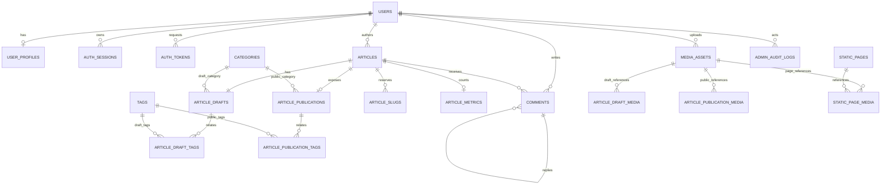

# XiaoWork Blog V1.0 数据库详细设计说明书（DD）

> **文档版本：** V1.0-Draft 1（数据库评审稿）  
> **日期：** 2026-10-22  
> **设计基线：** 《XiaoWork Blog V1.0 产品需求文档（PRD）》及《系统架构设计说明书（SAD）》  
> **技术基线：** PostgreSQL 18，Go + Chi，pgx/sqlc；迁移工具建议 goose  
> **状态：** 仅进行数据库逻辑与物理规格设计；**未编写 DDL、迁移脚本或业务代码，未连接实际数据库。**

---

## 1. 设计目标和范围

本设计为 V1.0 必需功能定义可实施的数据模型：邮箱注册与验证、服务端登录会话、Markdown 文章与独立编辑草稿、文章发布快照、分类标签、评论直接公开、本地图片、站点设置、搜索、审计与安全限流。

**必须保持的产品约束：**

1. 已发布文章编辑时，所有草稿变化（标题、封面、Slug、分类标签、正文、SEO、评论开关）都不能提前作用于公开版本；只有明确点击“发布更新”才发生公开切换。
2. 评论归属于文章的稳定 ID，不归属于某个版本；已验证并登录、未被禁用的用户提交合法评论后直接公开，不设审核队列。
3. 正常游客不能得到用户邮箱、会话凭据、未公开文章或草稿媒体。
4. 文章撤回、删除后，公开搜索、详情、RSS 与 Sitemap 都不能继续读到文章；旧地址在文章公开时才可重定向。
5. 图片实际数据保存在宿主机持久化目录，数据库仅记录元数据和引用关系；文件与数据库的一致性由服务层协同保证。
6. V1.0 不实现多租户、多作者协作、文章历史多版本归档、复杂 RBAC、点赞、审核队列及外部对象存储。

## 2. 数据库总原则

| 项目 | 统一规则 |
|---|---|
| 数据库 | PostgreSQL 18（正式部署锁定经测试的小版本） |
| 主键 | 核心实体采用 `uuid`，由可信应用层生成；非安全授权依据 |
| 时间 | 所有事件时间 `timestamptz`，应用用 UTC 写入，展示按用户时区格式化 |
| 文本 | UTF-8；业务字符数和字节数由 API 双重限制 |
| 空值 | “缺省”和“空内容”含义不同；需要时允许 `NULL`，禁止用空字符串表示所有状态 |
| 金额 | V1.0 无支付等金额字段 |
| 布尔及状态 | 使用 `boolean` / 有限状态 `varchar` + `CHECK`，避免散落魔法数字 |
| 外键 | 实体间有稳定关系时使用数据库 FK；优先 `RESTRICT/NO ACTION`，谨慎级联删除 |
| 唯一键 | 用唯一约束或唯一索引保证，不只靠 API 先查询 |
| 软删除 | 文章使用生命周期状态；评论采用墓碑状态；上传文件独立清理 |
| 敏感凭据 | 密码只存 Argon2id 哈希；Session / 邮件一次性令牌只存摘要 |
| JSONB | 仅限审计详情等灵活字段；核心业务不放进万能 JSONB |
| 索引 | 以真实查询负载、执行计划验证，避免机械地给每列建索引 |

### 2.1 一致性边界

- 单个 PostgreSQL 事务可原子保证文章公开快照、公开标签、旧 Slug、索引文本及审计记录的一致性。
- 文件系统、SMTP **不参加** PostgreSQL 事务；必须用临时文件、完成标记、补偿和重试处理。
- 默认使用 `READ COMMITTED`；需要串行的同文章发布、口令一次性消费操作显式锁行或使用唯一约束/条件更新。
- 与另一张表有关的规则（如评论的父评论必须属于同一文章）优先用复合外键；复杂规则留在 Go 服务层并做集成测试。PostgreSQL `CHECK` 无法跨表安全表达此类规则。

## 3. 总体实体与关系

共建议 **24 张业务及支撑表**，按六组划分：

| 领域 | 表名 | 数量 |
|---|---|---:|
| 用户与安全 | `users`、`user_profiles`、`auth_sessions`、`auth_tokens`、`auth_rate_windows` | 5 |
| 文章与组织 | `articles`、`article_drafts`、`article_publications`、`article_slugs`、`categories`、`tags`、`article_draft_tags`、`article_publication_tags`、`article_metrics` | 9 |
| 评论 | `comments` | 1 |
| 本地媒体及引用 | `media_assets`、`article_draft_media`、`article_publication_media`、`static_page_media` | 4 |
| 站点配置 | `site_settings`、`site_social_links`、`site_navigation_links`、`static_pages` | 4 |
| 管理员审计 | `admin_audit_logs` | 1 |
| **总计** | | **24** |

> 表数是当前实现规格，不代表一定要建设 24 套独立模块；所有表属于**同一个 PostgreSQL 数据库、一个 Go 模块化单体服务**。不要求任何微服务。

> ER 图为主要关系示意，未画出站点配置引用头像、Logo、Favicon 以及评论复合外键，实际以本章表规格为准。

## 4. 用户与认证表（5）

### 4.1 `users` — 账号主表

| 字段 | 类型/默认 | 必填 | 说明及约束 |
|---|---|---|---|
| `id` | `uuid`，PK | 是 | 稳定用户 ID |
| `email` | `varchar(254)` | 是 | 用于发信与个人界面展示，永不进入公开评论 API |
| `email_normalized` | `varchar(254)`，UNIQUE | 是 | 账号匹配使用；统一邮箱规范化策略，去首尾空格、标准化域名、产品级大小写规则 |
| `password_hash` | `text` | 是 | Argon2id 编码串；不存明文或可逆密文 |
| `nickname` | `varchar(40)` | 是 | 显示名，非唯一；1–40 字符 |
| `role` | `varchar(16)` | 是 | `USER` / `ADMIN`，默认 USER；公开注册不得设置 ADMIN |
| `status` | `varchar(16)` | 是 | `ACTIVE` / `DISABLED`，默认 ACTIVE |
| `email_verified_at` | `timestamptz` | 否 | `NULL` 表示未验证 |
| `password_changed_at` | `timestamptz` | 否 | 重置密码与会话失效判断依据 |
| `created_at` / `updated_at` | `timestamptz` | 是 | 注册与更新日期 |

**约束：** `UNIQUE(email_normalized)`；`CHECK role/status`；禁止邮箱字段成为公开用户查询的默认响应内容。修改邮箱在确认新邮箱有效后才原子替换，不允许仅修改 `email` 而忘记唯一键。

**邮件规范化特别说明：** 邮箱本地部分在互联网规范上并非完全大小写无关；本博客出于账号体验采用**产品级大小写不敏感的唯一性规则**，需在实现前明确 ASCII/IDN 域名和 Unicode 策略。不要通过 Gmail 特有的点号/加号规则合并任意邮箱。

### 4.2 `user_profiles` — 用户扩展资料

| 字段 | 类型 | 说明 |
|---|---|---|
| `user_id` | `uuid` PK/FK `users.id` | 一对一 |
| `avatar_media_id` | `uuid` NULL / FK `media_assets.id` | 当前头像；可使用默认头像 |
| `bio` | `varchar(200)` NULL | 用户简介，可为空 |
| `updated_at` | `timestamptz` | 资料最近修改 |

默认昵称来自 `users.nickname`；将头像 FK 放在资料表可以避免用户与媒体上传人之间的循环建表依赖。用户删除目前不开放，未来再定义数据擦除策略。

### 4.3 `auth_sessions` — 可撤销的服务端会话

| 字段 | 类型 | 说明 |
|---|---|---|
| `id` | `uuid` PK | 内部会话记录 ID |
| `user_id` | `uuid` FK | 所属用户 |
| `token_digest` | `bytea` UNIQUE | 高熵随机会话令牌的 SHA-256 摘要；**不保存明文** |
| `created_at` | `timestamptz` | 登录时间 |
| `last_seen_at` | `timestamptz` NULL | 最近活动；允许节流写入 |
| `expires_at` | `timestamptz` | 绝对到期时间 |
| `revoked_at` | `timestamptz` NULL | 主动退出、封禁或重置密码后撤销 |

禁止到期/撤销会话继续认证；每次敏感请求仍检查 `users.status` 与 `email_verified_at`。Cookie 只保存随机凭据而不是这个表的内部 ID。

### 4.4 `auth_tokens` — 邮件一次性令牌

| 字段 | 类型 | 说明 |
|---|---|---|
| `id` | `uuid` PK | 令牌记录 ID |
| `user_id` | `uuid` FK | 关联用户 |
| `purpose` | `varchar(24)` | `VERIFY_EMAIL`、`RESET_PASSWORD`、`CHANGE_EMAIL` |
| `token_digest` | `bytea` UNIQUE | 仅存安全随机令牌摘要 |
| `target_email` | `varchar(254)` NULL | 修改邮箱时的新地址或验证目标；敏感字段 |
| `target_email_normalized` | `varchar(254)` NULL | 规范化目标邮箱；验证时再次唯一检查 |
| `created_at` / `expires_at` | `timestamptz` | 创建和到期 |
| `consumed_at` / `revoked_at` | `timestamptz` NULL | 一次性消费或作废 |

**约束及策略：** `expires_at > created_at`；同类重复申请需作废旧的未用令牌或明确并发策略；**不能**用依赖 `now()` 的部分索引表示“未过期唯一”，因为当前时间不是索引稳定谓词。消费需锁定令牌行并检查期限、状态、用户，条件更新后同时完成业务变化。注册验证建议 24 小时、密码重置 30 分钟，可通过配置调整。

注意邮件发送不是事务的一部分：创建摘要后 SMTP 发送失败时，应允许限流范围内重新申领令牌，并明确提示邮件未成功送达；不能为了自动重试将原始重置链接或明文令牌长期落库。

### 4.5 `auth_rate_windows` — 关键接口的持久化限流窗口

| 字段 | 类型 | 说明 |
|---|---|---|
| `action_key` | `varchar(32)` | 如 REGISTER、LOGIN、RESET、SEND_VERIFY、COMMENT |
| `subject_digest` | `bytea` | 使用服务端密钥派生的标识摘要，可由账号/IP 维度构成 |
| `window_started_at` | `timestamptz` | 固定窗口开始 |
| `request_count` | `integer` | 当前累计数，非负 |
| `expires_at` | `timestamptz` | 清理时间 |

复合主键 `(action_key, subject_digest, window_started_at)`；保留时间有限，后台不展示原始 IP。限流阈值由 API/运维配置；此表只服务需要跨进程重启继续约束的敏感操作，不要求给每一次公开读请求写数据库。

## 5. 文章、分类及搜索表（9）

### 5.1 `articles` — 文章身份与生命周期

| 字段 | 类型 | 说明 |
|---|---|---|
| `id` | `uuid` PK | 不因编辑、修改 Slug 而变化 |
| `author_id` | `uuid` FK `users.id` | 当前版本仅管理员创建 |
| `status` | `varchar(16)` | `DRAFT` / `PUBLISHED` / `WITHDRAWN` / `TRASHED` |
| `first_published_at` | `timestamptz` NULL | 首次成功发布的时间，之后不重写 |
| `public_updated_at` | `timestamptz` NULL | 最近成功公开更新的时间 |
| `last_published_draft_revision` | `bigint` NULL | 最近成功发布采用的草稿修订号 |
| `created_at` / `updated_at` | `timestamptz` | 对象创建及内部生命周期变化 |
| `trashed_at` / `withdrawn_at` | `timestamptz` NULL | 用于后台管理与恢复 |

规则：只有 `status='PUBLISHED'` 并且 `article_publications` 有有效行的文章可被公开查询。撤回/删除后保留公开快照供后续恢复处理，但公开 API 必须按 `articles.status` 过滤。回收站恢复**只回到非公开状态**（曾发布的恢复为 WITHDRAWN，否则 DRAFT），不自动上线。

### 5.2 `article_drafts` — 当前编辑草稿（一文章一行）

| 字段 | 类型 | 说明 |
|---|---|---|
| `article_id` | `uuid` PK/FK `articles.id` | 每篇文章只有一份当前草稿 |
| `revision` | `bigint` | 初始 1；每次成功保存 +1，要求大于 0 |
| `title` | `varchar(200)` | 编辑中标题，可为空串但禁止发布为空 |
| `summary` | `text` NULL | 手动摘要，可在发布时自动生成 |
| `body_markdown` | `text` | **Markdown 原文** |
| `candidate_slug` | `varchar(160)` NULL | 尚未对外生效的 URL 候选值 |
| `category_id` | `uuid` NULL/FK `categories.id` | 草稿分类 |
| `cover_media_id` | `uuid` NULL/FK `media_assets.id` | 草稿封面 |
| `seo_title` / `seo_description` | `varchar(200)` / `varchar(320)` NULL | 草稿 SEO |
| `comments_enabled` | `boolean` DEFAULT TRUE | 草稿评论开关 |
| `saved_at` | `timestamptz` | 草稿保存时间 |
| `last_edited_by` | `uuid` FK `users.id` | 最后编辑人 |

`revision` 以条件更新实施乐观锁：客户端传来当前修订号，已被别的窗口更新则返回 `409`，不能覆盖较新草稿。发布前须检查标题、正文、Slug（如有）和资源引用。

### 5.3 `article_publications` — 当前公开快照（一文章最多一行）

| 字段 | 类型 | 说明 |
|---|---|---|
| `article_id` | `uuid` PK/FK `articles.id` | 公开快照归属 |
| `publication_revision` | `bigint` | 首次为 1，每次真实发布更新 +1 |
| `source_draft_revision` | `bigint` | 本次公开来自哪个草稿修订号 |
| `title` | `varchar(200)` | 公开标题 |
| `summary` | `text` | 已生成或手填的公开摘要 |
| `body_markdown` | `text` | 公开正文原始 Markdown |
| `body_plain_text` | `text` | Markdown 解析后的公开纯文本，用于搜索 |
| `slug` | `varchar(160)` | 当前实际对外地址，唯一性的权威来源见 `article_slugs` |
| `category_id` | `uuid` NULL/FK `categories.id` | 公开分类 |
| `cover_media_id` | `uuid` NULL/FK `media_assets.id` | 公开封面 |
| `seo_title` / `seo_description` | `varchar(200)` / `varchar(320)` NULL | 公开 SEO 值 |
| `comments_enabled` | `boolean` | 公开评论开关 |
| `published_at` | `timestamptz` | 本次公开切换时间 |

**不保存完整的历史快照列表**，每次发布覆盖当前公开行。必须与公开标签和媒体关联一起在事务中更新。

### 5.4 `article_slugs` — 当前及历史地址保留表

| 字段 | 类型 | 说明 |
|---|---|---|
| `slug` | `varchar(160)` PK | 全站已占用过的文章 Slug，永不复用 |
| `article_id` | `uuid` FK `articles.id` | 属于哪个文章 |
| `is_current` | `boolean` | 是否为此文章当前公开地址 |
| `created_at` | `timestamptz` | 开始占用的时间 |

唯一规则：`slug` 全局唯一；对同一 `article_id` 建**部分唯一索引** `WHERE is_current = TRUE`，确保最多一条当前 Slug。首次发布才注册候选 Slug；草稿改 Slug 不占坑。撤回/删除仍保留占用记录但一律不 301 展示内容。旧地址只有目标文章处于 PUBLISHED 时才 301 到 `article_publications.slug`。

### 5.5 `categories` — 分类

| 字段 | 类型 | 说明 |
|---|---|---|
| `id` | `uuid` PK | 分类 ID |
| `name` | `varchar(60)` | 显示名 |
| `slug` | `varchar(100)` UNIQUE | 分类地址，分类空间内唯一 |
| `description` | `varchar(300)` NULL | 可选说明 |
| `sort_order` | `integer` DEFAULT 0 | 后台排序 |
| `is_active` | `boolean` DEFAULT TRUE | 可选用/停用 |
| `created_at` / `updated_at` | `timestamptz` | 时间 |

分类被草稿或公开文章关联时不允许直接物理删除，应先迁移文章或禁用；文章默认未选分类时前台表现为“未分类”，**不需要创建可被误删的系统保留分类行**。

### 5.6 `tags` — 标签

`id uuid PK`、`name varchar(60)`、`slug varchar(100) UNIQUE`、`sort_order integer`、`is_active boolean`、`created_at/updated_at timestamptz`。标签的全局改名是管理员维护标签字典的操作，可即时影响既有公开文章的标签名称；**但编辑某篇文章的标签关联，只能在该文章发布更新后公开生效**。

### 5.7 `article_draft_tags` — 草稿标签关联

复合主键 `(article_id, tag_id)`；`article_id` FK 指向 `article_drafts.article_id`，`tag_id` FK 指向 `tags.id`。草稿更改关联仅修改本表；不会读写公开标签。

### 5.8 `article_publication_tags` — 公开标签关联

复合主键 `(article_id, tag_id)`；`article_id` FK 指向 `article_publications.article_id`，`tag_id` FK 指向 `tags.id`。发布事务内从草稿标签整体替换，任何一处失败事务回滚，不允许新正文与旧标签混杂。

### 5.9 `article_metrics` — 轻量阅读量

`article_id uuid PK/FK articles.id`、`view_count bigint NOT NULL DEFAULT 0 CHECK >= 0`、`updated_at timestamptz`。阅读量仅是**近似页面访问量**，不计作独立访客；应避免 SSR 预取、爬虫、重复刷新等无意义事件直接计数。计数采用原子自增或小批聚合，不能每次访问锁定文章公开正文行。是否引入防重复 Cookie 由后续 API 设计决定。

## 6. 评论表（1）

### 6.1 `comments`

| 字段 | 类型 | 说明 |
|---|---|---|
| `id` | `uuid` PK | 评论唯一 ID |
| `article_id` | `uuid` FK `articles.id` | 绑定稳定文章 ID，不绑定公开版本 |
| `author_id` | `uuid` FK `users.id` | 评论用户 |
| `parent_id` | `uuid` NULL | 被直接回复的评论；根评论为 NULL |
| `root_id` | `uuid` NULL | 所属根评论；根评论为 NULL，回复必须填根 ID |
| `body_text` | `text` NULL | 仅支持安全文本；删除后清空正文 |
| `status` | `varchar(20)` | `VISIBLE` / `HIDDEN` / `DELETED_AUTHOR` / `DELETED_ADMIN` |
| `created_at` / `updated_at` | `timestamptz` | 评论时间 |
| `deleted_at` / `hidden_at` | `timestamptz` NULL | 治理与墓碑时间 |

**完整性约束：** 增设 `(article_id, id)` 唯一约束，`(article_id,parent_id)` 和 `(article_id,root_id)` 复合外键指向同一表 `(article_id,id)`；可强制不跨文章回复。根评论必须 `parent_id IS NULL AND root_id IS NULL`；回复必须两者都有，且 Service 保证 root_id 指向根评论、禁止循环/自回复。不依赖数据库 `CHECK` 访问别的评论行。

**逻辑：** 只要文章 PUBLISHED 且公开快照 `comments_enabled = TRUE`，账号 ACTIVE 且邮箱已验证，评论安全校验与限流通过即可插入 `VISIBLE`。历史评论在关闭评论后照常可读。管理员隐藏可恢复；用户主动删除时清除正文但保留必要墓碑和回复关系。楼中楼真实父子关系存储，前台只绘制两层缩进。

**分页口径：** 首先分页取 20 条顶层评论（`parent_id IS NULL`，稳定排序 `created_at,id`），再按根 ID 批量取回复，避免每条评论单独查询数据库；深回复需按根分页，禁止无限展开一次取完。公开默认最新优先，回复内部按时间升序。管理员可以按文章、用户和状态筛选。

## 7. 图片及其引用关系（4）

### 7.1 `media_assets` — 实际文件元数据

| 字段 | 类型 | 说明 |
|---|---|---|
| `id` | `uuid` PK | 图片标识；对外路径使用不暴露宿主机绝对路径的标识 |
| `uploaded_by` | `uuid` FK `users.id` | 上传者；普通用户仅允许上传自己的头像 |
| `usage_kind` | `varchar(20)` | `ARTICLE` / `AVATAR` / `SITE` / `PAGE`；限制用途 |
| `storage_key` | `text` UNIQUE | 私有的相对存储键；不得含 `..` 等非法路径 |
| `original_filename` | `varchar(255)` | 展示用文件名，必须转义输出 |
| `mime_type` | `varchar(40)` | 校验后的 JPEG/PNG/WebP/GIF |
| `size_bytes` | `bigint` | 文件大小，`> 0` 且不得超过配置上限 |
| `width` / `height` | `integer` | 大于 0，拒绝异常尺寸 |
| `sha256` | `bytea` NULL | 文件完整性校验，可选用于恢复检查 |
| `state` | `varchar(20)` | `READY` / `PENDING_DELETE` / `DELETED` |
| `created_at` / `deleted_at` | `timestamptz` / NULL | 生命周期时间 |

公开访问权**不能只依赖 `media_assets.state='READY'`**；必须判断它是否被公开文章、公开站点/关于页或可公开用户头像合法引用。已上传但只用于管理员草稿的图片，匿名请求应返回 404 或等价不可见结果。图片文件访问通过 Go 的受控读取端点，文件系统不可作为无权限检测的裸静态目录发布。

### 7.2 `article_draft_media`

复合主键 `(article_id, media_id)`；两列分别 FK 到 `article_drafts` 和 `media_assets`。覆盖草稿封面与原始 Markdown 中所有**本站媒体引用**。上传后统一生成本站媒体标识形式的 URL/引用；在保存草稿时解析、校验后更新映射。引用扫描不能依靠简单文本子串匹配。

### 7.3 `article_publication_media`

复合主键 `(article_id, media_id)`；两列分别 FK 到 `article_publications` 和 `media_assets`。发布时校验所有本站图片可读、READY 且权限正确，再与公开内容原子同步。公开图片访问判断以本表及其他允许公开用途关系为依据；撤回/删除时虽可保留行，判断仍必须检查文章状态。

### 7.4 `static_page_media`

复合主键 `(page_key, media_id)`；`page_key` FK 到 `static_pages.page_key`，`media_id` FK 到 `media_assets.id`。用于关于页 Markdown 引用，关于页由管理员显式保存即生效。站点 Logo/Favicon/个人头像以 `site_settings` 的字段 FK 管理，普通用户头像以 `user_profiles` FK 管理，**删除文件必须汇总检查全部引用通道**。

### 7.5 删除与备份一致性

- 文件删除前确认无草稿、公开快照、用户头像、站点设置、关于页引用；FK 应阻止遗漏的关联；管理员收到“资源正在使用”的错误。
- 对未引用文件先标记 `PENDING_DELETE`，文件删除后标记 DELETED；中途故障需能重试，避免数据库说文件存在但文件已消失。
- 存储路径只能由后端生成和解析；上传时先写隔离临时文件，校验成功后原子改名，最后提交数据库记录；失败后补偿临时/孤儿文件。
- 图片备份与数据库备份应具有一致性窗口或清单，恢复时逐项核对关联文件；仅 Docker volume 不等于备份。
- 对曾公开的图片不能承诺追回已被用户或缓存保存的副本；首版对需要即时撤回权限的媒体不使用不可撤销的长期公开缓存。

## 8. 网站设置与管理员审计（5）

### 8.1 `site_settings` — 单行站点配置

使用 `id smallint PK CHECK (id=1)` 保证单例（部署初始数据创建），字段包括：

| 字段 | 类型 | 说明 |
|---|---|---|
| `site_title` / `site_description` | `varchar(120)` / `varchar(320)` | 站名、描述 |
| `profile_name` / `profile_bio` | `varchar(80)` / `varchar(240)` | 前台左侧个人信息 |
| `profile_avatar_media_id` | `uuid` NULL/FK | 个人栏头像 |
| `logo_media_id` / `favicon_media_id` | `uuid` NULL/FK | 网站图标 |
| `contact_email` | `varchar(254)` NULL | 公开联系邮箱；与用户注册邮箱不同 |
| `default_seo_title` / `default_seo_description` | `varchar(200)` / `varchar(320)` NULL | SEO 默认值 |
| `updated_at` | `timestamptz` | 最近修改时间 |

**不能**在数据库公共站点设置里保存 SMTP 密码、会话密钥、数据库连接凭据；敏感运行配置在受限环境变量/密钥文件中。

### 8.2 `site_social_links` — 左侧外链图标

`id uuid PK`、`icon_key varchar(40)`、`label varchar(80)`、`url text`、`sort_order integer`、`is_enabled boolean`、`created_at/updated_at timestamptz`。后台只允许预设图标集合/安全 URL 协议（如 HTTPS、mailto），渲染时使用安全 `rel` 属性；不接受可执行脚本 URL。该表**不**存文章分类、天气等左栏复杂组件。

### 8.3 `site_navigation_links` — 顶部基础导航

`id uuid PK`、`label varchar(60)`、`link_type varchar(12)`（`INTERNAL`/`EXTERNAL`）、`url text`、`sort_order integer`、`is_enabled boolean`、`created_at/updated_at timestamptz`。内部链接验证本站路由，外部地址校验协议；后台避免产生需要认证才能访问的公开导航目标。

### 8.4 `static_pages` — V1.0 简易关于页

`page_key varchar(32) PK`（V1.0 仅 `about`）、`title varchar(160)`、`body_markdown text`、`body_plain_text text`、`updated_by uuid FK users.id`、`updated_at timestamptz`。由管理员**显式保存即公开生效**；文章专属的“公开快照与独立草稿分离”机制不自动扩展到关于页。如以后需要其他独立页面再评审扩展。

### 8.5 `admin_audit_logs` — 管理员操作审计

`id uuid PK`、`actor_user_id uuid FK users.id`、`action varchar(64)`、`object_type varchar(40)`、`object_key varchar(256)`、`request_id varchar(64)`、`details jsonb NULL`、`created_at timestamptz`。至少审计文章发布/撤回/回收、用户封禁/恢复、评论隐藏/删除、站点重要设置变更。不存口令、Token、Cookie、完整私人邮件内容；可配置保留期并限制后台读取权限。

## 9. 索引设计（初版建议）

**主键、UNIQUE 约束已自动拥有相应唯一 B-tree 索引，不再额外复制创建。** PostgreSQL 并不自动给所有外键的引用列建立索引，需根据访问及删除检查场景增加。所有新增索引通过 `EXPLAIN (ANALYZE, BUFFERS)` 和真实内容量验证。

| 表 | 索引或访问路径 | 服务的查询 |
|---|---|---|
| `users` | UNIQUE `email_normalized` | 注册冲突、登录、密码重置 |
| `auth_sessions` | UNIQUE `token_digest`，`(user_id,expires_at)` | 认证校验、某用户会话撤销 |
| `auth_tokens` | UNIQUE `token_digest`，`(user_id,purpose,created_at DESC)`；`expires_at` | 消费和清理一次性令牌 |
| `auth_rate_windows` | PK `(action_key,subject_digest,window_started_at)`，`expires_at` | 限流及过期清理 |
| `articles` | `(status,first_published_at DESC,id DESC)` | 首页、归档和公开列表 |
| `articles` | `(author_id,updated_at DESC)` | 管理员文章列表 |
| `article_drafts` | PK 与按 `revision` 的条件更新 | 自动保存乐观锁 |
| `article_publications` | PK 与 `slug` 用于校验的读取 | 详情、发布快照 |
| `article_slugs` | PK `slug`、UNIQUE `(article_id)` **WHERE `is_current`** | 当前/历史 Slug；每文章最多一个当前地址 |
| `categories` / `tags` | 各自 UNIQUE `slug`、`(is_active,sort_order)` | 分类标签页及后台排序 |
| 两个标签关联表 | PK `(article_id,tag_id)` + 额外 `(tag_id,article_id)` | 按文章取标签、按标签查文章 |
| `comments` | `(article_id,parent_id,created_at DESC,id DESC)` | 顶级评论分页 |
| `comments` | `(article_id,root_id,created_at ASC,id ASC)` | 批量加载回复 |
| `comments` | `(author_id,created_at DESC,id DESC)` | 我的评论与管理员用户评论查询 |
| `media_assets` | UNIQUE `storage_key`、`(uploaded_by,created_at DESC)` | 媒体库及用户头像管理 |
| 各媒体引用表 | PK `(article_id/media page,media_id)` + 反向 `media_id` 索引 | 检查“此图片是否被引用” |
| `site_social_links` / `site_navigation_links` | `(is_enabled,sort_order,id)` | 公开页面导航及外链 |
| `admin_audit_logs` | `(created_at DESC,id DESC)`、`(actor_user_id,created_at DESC)` | 审计查询 |

### 9.1 全文搜索策略

公开搜索数据只取 `article_publications`，并 JOIN `articles` 要求 `status=PUBLISHED`。可维护 `title + summary + body_plain_text` 的搜索组合视图或独立 `search_text` 字段（第一版推荐**不增加冗余搜索表**）。在发布事务中刷新 `body_plain_text`；索引优先对实际 `ILIKE` 使用表达式及 `pg_trgm` 的 GIN 索引，标题可另行提高排序权重。

**中文搜索必须专项验收：** 使用“容器”“容器化”“数据库”“Java”“Go”“Spring Boot”“Vue 3”“Docker Compose”等样本测试短词、英文术语、混合语言、大小写及分页。`pg_trgm` 适合部分模糊匹配，但并不等于高质量中文分词器；少于 3 字符的查询可能收益有限，依据执行计划选择小表扫描、有限回退或后续专用检索优化。V1.0 不引入 Elasticsearch。

> PostgreSQL 文档：唯一约束与部分唯一索引可直接限定合法状态；多列外键适合约束同文章父子回复；`pg_trgm` 提供 GIN/GiST 搜索支持。参考：
> - https://www.postgresql.org/docs/18/indexes-unique.html
> - https://www.postgresql.org/docs/18/indexes-partial.html
> - https://www.postgresql.org/docs/18/ddl-constraints.html
> - https://www.postgresql.org/docs/18/pgtrgm.html

## 10. 关键事务与状态机

### T01 — 注册与邮箱验证

1. 输入邮箱按统一规则规范化；插入 `users`（role=USER、status=ACTIVE、未验证）与默认 `user_profiles`。
2. 创建 VERIFY_EMAIL 随机令牌，将摘要写入 `auth_tokens` 并提交；明文令牌只在内存中组装 SMTP 链接。
3. SMTP 成功发送才向用户表达“已发送”；失败如实反馈，可在限流下重新发起。
4. 验证时锁定令牌与用户，确认未消费、未撤销、未过期且邮箱目标一致；同时更新 `email_verified_at` 并标记 `consumed_at`。并发点击只允许一个成功。
5. 登录时检查哈希和账号状态，写 Session 摘要，Cookie 返回原始随机凭据。

### T02 — 忘记密码、修改邮箱、撤销会话

- 找回密码无论邮箱是否存在，对外响应一致；符合条件的账户创建 RESET_PASSWORD 令牌。
- 重置时事务中消费令牌、更新密码哈希与 `password_changed_at`、撤销当前所有相关 Session 与旧未消费重置令牌；不允许重复生效。
- 修改邮箱使用 `CHANGE_EMAIL` 令牌；在确认新邮箱控制权并重新检查唯一约束后原子修改两个邮箱字段。原邮箱在完成验证前保持为正式邮箱；必要时撤销旧 Session。
- 管理员禁用账号后，请求实时校验 `users.status`，并撤销已有会话，避免仅依赖登录时用户状态。

### T03 — 新建、自动保存与发布

1. 新建文章：插入 `articles(status=DRAFT)`、`article_drafts(revision=1)` 和初始空关联。
2. 自动保存：对 `article_drafts` 的 `revision` 做 CAS（比较并更新），同时修改 `article_draft_tags` 和 `article_draft_media`；**这套变更在一个数据库事务中完成**。
3. 发布：事务内锁定 `articles` 行，确认传入草稿修订号匹配；校验分类/标签/媒体及 Slug 的可用性；更新或插入 `article_publications`，同步复制 `article_publication_tags`、`article_publication_media`，注册/调整 `article_slugs`，更新 `articles` 生命周期及公开时间，写审计日志，再统一提交。
4. 发布后公开内容仅依赖公开快照；`last_published_draft_revision` 记住本次来源。若草稿没有任何新修改，重复发布按无变化幂等响应处理，不再增加公开修订号或更新时间。
5. 旧 Slug 301 仅在当前文章公开时生效；候选新 Slug 被占用时发布失败并回滚，返回冲突错误。

**并发关键点：** 同文章的草稿保存与发布须有一致的锁定顺序，均先锁 `articles` 行再操作草稿及关联，避免发布复制到一半草稿又变动。另一篇文章的 Slug 并发竞争由数据库唯一键裁决；捕获唯一冲突后返回 409。应覆盖双标签页编辑、重复发布点击、同一 Slug 并发发布的集成测试。

### T04 — 撤回、回收与恢复

- 撤回：在事务中将文章置为 WITHDRAWN，并写审计；公开 API 以状态过滤，不出现旧文章或其图片引用的公开访问入口。
- 软删除：置为 TRASHED，记录时间；不删除评论及媒体文件。
- 恢复：根据是否曾成功发布还原为 WITHDRAWN 或 DRAFT；**绝不未经明确发布自动变回 PUBLISHED**。
- 删除评论不会级联删除回复。评论状态改为删除墓碑、正文清空；管理员隐藏可恢复。

### T05 — 发表评论

1. 查当前账号 ACTIVE + 已验证邮箱 + Session 有效。
2. 在数据库事务中确认文章 PUBLISHED 且当前公开版本允许评论（必要时锁住文章/公开配置读取，避免关闭评论和并发发表评论互相竞态）。
3. 校验长度、文本、限流、同文章父评论及根评论归属。
4. 插入 `comments(status=VISIBLE)`，成功提交后即可对外查询；无审核状态。
5. 作者删除改墓碑，管理员隐藏可恢复。文章撤回后公开评论接口连带不可访问。

### T06 — 上传与删除图片

- 先上传临时文件并校验 MIME、魔数、像素、尺寸；生成非用户可控文件键并移动到持久化目录，记录 `media_assets`。
- 保存 Markdown 或网站配置时更新引用关系；引用变更要在对应内容事务中提交。
- 删除时数据库检查所有引用，若有引用直接拒绝；无引用标记 PENDING_DELETE，再删除文件并最终标记 DELETED。失败时可以重复完成清理，不会误删引用资源。
- 数据备份需要覆盖图片目录、数据库和受控配置；服务器或卷损坏时仍应具有异机/异盘可用备份。

## 11. 性能、留存、迁移与运行维护

### 11.1 常见查询及分页

| 场景 | 必须满足 |
|---|---|
| 首页文章列表 | 只查询 PUBLISHED；先按发布时间降序、再按 ID 固定排序；避免正文大字段参与列表查询 |
| 文章详情 | Slug → article ID → PUBLISHED 判定 → 公开快照；草稿不进入公开查询 |
| 分类/标签页 | 使用公开关联表过滤，并排除撤回/回收站文章 |
| 归档 | 按 `first_published_at` 的年/月统计公开文章 |
| 评论 | 按根评论分页，回复批量查；避免 N+1 |
| 用户中心 | 通过 `author_id` 和分页查询我的评论，不能读取他人的私密账号资料 |
| 管理后台 | 读可筛选的摘要列表，长 Markdown 正文按详情单独加载 |
| 搜索 | 搜索公开快照，不搜索草稿；限制词长、排序和最大分页大小 |

V1.0 默认分页建议：文章 10 条/页，顶层评论 20 条/页，后台用户/媒体 20 条/页；API 层设最大每页 100 条。发生同时间戳时使用 ID 作为稳定次序。

### 11.2 保留/清理策略

- `auth_tokens`、已过期/撤销 Session、限流桶：按 TTL 后周期清理；**过期判断每次使用时实时执行**，不能只靠清理任务。
- 评论删除墓碑：默认保留父子树所需元数据，清理正文，用户邮箱始终不公开。
- 文章回收站：默认不做自动永久删除，后续若引入保留期限需另行评审。
- 图片孤儿文件：定期列出存储目录与 `media_assets` 不一致项目，生成检查/清理报告；首版不自动盲删无法判明归属的文件。
- 审计日志：保留策略按管理员和运营需要配置，任何清理不得破坏核心业务数据。

### 11.3 迁移与版本管理

- goose 或等价数据库迁移工具；迁移文件随应用版本管理，CI 在真实 PostgreSQL 上执行。
- 迁移与应用版本成对发布。优先向前兼容（Expand → Migrate → Contract），禁止未经备份直接删列/改数据类型。
- 部署流程：**备份与恢复点确认 → 迁移验证 → 升级应用 → 健康检查 → 冒烟测试**。
- 数据库故障或迁移失败时必须明确停止后续部署；业务回退不等于数据库自动回退，必要时依照恢复预案处理。
- 生产数据库账号采用最小权限：运行时账号不授予任意 DDL 与扩展安装权限；迁移使用单独受控权限账号。
- 尽量避免直接依赖 `superuser`；`pg_trgm` 扩展由受控迁移/初始化步骤创建。

### 11.4 备份与恢复

1. 推荐每日数据库逻辑备份以及媒体文件备份，并至少保留一份**独立于主机/主盘**的副本。
2. 备份记录应用版本、数据库迁移版本、开始/结束时间、媒体清单和完整性校验信息。
3. 建议对备份窗口限制媒体写入，或采用能对应数据库一致性时点的快照/manifest；单独“分别复制两个目录”不能保证严格一致。
4. 在隔离环境实际恢复 `users/articles/comments/media`，验收公开版本、草稿版本、历史 Slug、评论图片和邮箱账号是否保持正确关联。
5. 备份文件包含邮箱、密码哈希、令牌摘要，必须控制访问并加密；不进入 GitHub 仓库。

## 12. 安全和隐私检查

- 强制数据库唯一键：邮箱、Slug、Session 摘要、一次性令牌摘要、媒体存储键。
- 管理员权限在 Go API 判断；UI 是否显示按钮不可作为权限来源。
- 不公开 `users.email`、`password_hash`、`auth_sessions`、`auth_tokens`、`auth_rate_windows` 或 `admin_audit_logs`。
- Markdown 的 HTML/URL 安全过滤在渲染层实施，数据库存储 Markdown 不代表可安全直接输出。
- 用户评论只输出可安全显示的文本、昵称、头像和发布时间；状态隐藏/删除者不公开原正文。
- 注册、登录、重置、评论、上传限流；真实来源 IP 只接受可信 NPM 转发链，审计与限流数据限期保留。
- 任何“管理员预览草稿”和“私有媒体查看”都必须经过服务端权限核验；`robots.txt` 不代替授权。

## 13. 数据库集成测试清单

| 编号 | 用例 | 通过条件 |
|---|---|---|
| DB-01 | 同邮箱不同大小写并发注册 | 同一规范化邮箱最多一行，其他请求返回冲突 |
| DB-02 | 未验证/禁用用户评论 | 插入被 API 拒绝，不能绕过权限服务 |
| DB-03 | 验证邮件令牌并发消费 | 最多一次成功；过期、撤销、重复均无效 |
| DB-04 | 重置密码 | 密码更改、Token 一次性、旧 Session 撤销同时完成 |
| DB-05 | 已发布文章自动保存草稿 | 公开标题、正文、分类、标签、封面、Slug 全部不变 |
| DB-06 | 文章发布失败或冲突 | 公开快照、标签、Slug、发布时间等要么全成功要么全部回滚 |
| DB-07 | 两管理员窗口同时保存草稿 | 旧 revision 更新返回冲突，新版本保留 |
| DB-08 | 重复发布同一修订 | 不重复修改公开时间或增加公开修订号 |
| DB-09 | 旧 Slug 访问 | 公开状态 301；撤回/删除后不对外跳转 |
| DB-10 | 同时发布相同 Slug 的不同文章 | 数据库唯一键只允许一个成功 |
| DB-11 | 跨文章父回复 | 复合 FK 阻止错误引用；API 返回明确错误 |
| DB-12 | 删除带回复评论 | 原文不可公开、回复结构保留 |
| DB-13 | 管理员隐藏与恢复 | VISIBLE/HIDDEN 状态及公开查询正确 |
| DB-14 | 草稿图片可见性 | 未公开引用的本地图片不可匿名读取 |
| DB-15 | 删除被引用图片 | 数据库引用检查阻止删除，不造成公开文章破图 |
| DB-16 | 中文/英文混合搜索 | 只返回公开文章；短词、大小写和分页符合验收要求 |
| DB-17 | 分类或标签调整 | 编辑某篇草稿关联不影响公开关联；发布后同时切换 |
| DB-18 | 数据库与媒体恢复 | 文章、图片、头像、评论、旧地址映射仍一致 |
| DB-19 | 迁移重复执行、失败中断 | 版本可追踪，失败不进入部分可用状态 |
| DB-20 | 历史已撤回文章 | 首页、搜索、RSS、Sitemap 与媒体访问权限按公开状态过滤 |

## 14. PRD / 架构需求映射

| 需求 | 数据表/机制 |
|---|---|
| POST-01~12 | `articles`、`article_drafts`、`article_publications`、`article_slugs`、分类标签关联、`article_metrics` |
| AUTH-01~08 | `users`、`user_profiles`、`auth_sessions`、`auth_tokens`、`auth_rate_windows` |
| COMMENT-01~08 | `comments`、账户状态、文章公开快照评论开关 |
| MEDIA-01~08 | `media_assets`、草稿/公开/关于页媒体关系、头像和站点媒体外键 |
| DISCOVER-01~06 | 公开快照和索引、Slug 注册、文章公开时间 |
| ADMIN-01~08 | 站点设置、导航、外链、审计日志及公开/管理查询视图 |
| UAT-01~14 | 上述事务、约束、索引、备份和 DB-01~20 集成测试 |

## 15. 设计决策及下阶段待确认事项

### 15.1 本次建议冻结为数据库基线

1. 核心表主键为 UUID；公开文章使用稳定 ID，而不是 Slug 作外键。
2. 一篇文章有一份当前草稿与至多一份当前公开快照，**不做历史文章版本表**。
3. 草稿/公开标签与图片关系分表，保证发布事务能够整体切换。
4. Slug 历史全站不复用，文章撤回后也不允许旧地址泄露内容。
5. 服务端持久化 Session；密码和令牌摘要最小化存储。
6. 评论正常插入就是 VISIBLE；隐藏与删除为后续治理状态，不出现 PENDING_APPROVAL。
7. 图片文件存宿主机，数据库保存元信息与显式引用，不在数据库写图片二进制。
8. 文章搜索以 PostgreSQL 为起点，不额外启用 Elasticsearch。

### 15.2 下一阶段 API 设计需量化（非新增需求）

- 文章 `revision` 请求字段、冲突响应、发布幂等键及并发规则。
- 评论内容长度、排序与回复分页细则；被隐藏父评论对子回复的展示策略。
- 注册/密码重置的响应码、防枚举提示、邮件限流与 Token TTL。
- 图片类型、文件体积、最大像素、访问路径与缓存时长。
- 站点设置字段、导航 URL 安全策略及社交图标允许列表。
- 文章阅读量统计触发方式与去重近似口径。
- 数据清理定时任务由 Go 服务内定时执行或单独运维命令执行；无需额外常驻服务。

### 15.3 本阶段明确没有开展

未创建任何 SQL 迁移脚本、数据库、连接配置、Go Repository、Nuxt 页面或 Docker 部署文件。本文是**数据库详细设计规格，不是已经执行的数据库初始化记录**。

---

## 附录：官方参考资料

- PostgreSQL 18 约束：https://www.postgresql.org/docs/18/ddl-constraints.html
- PostgreSQL 18 唯一索引：https://www.postgresql.org/docs/18/indexes-unique.html
- PostgreSQL 18 部分索引：https://www.postgresql.org/docs/18/indexes-partial.html
- PostgreSQL 18 `pg_trgm`：https://www.postgresql.org/docs/18/pgtrgm.html
- PostgreSQL 18 显式行锁：https://www.postgresql.org/docs/18/explicit-locking.html

**文档状态：可提交数据库设计评审；通过后进入 API 契约设计。**
